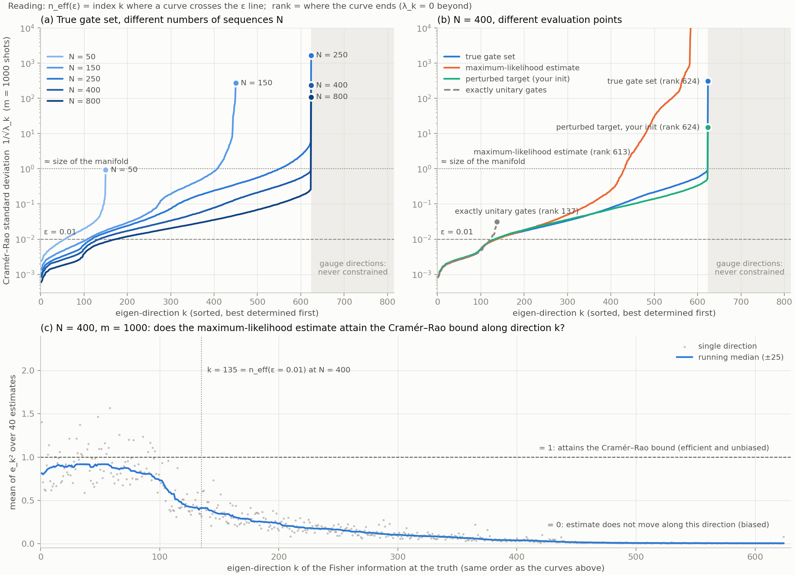

# Identifiability and Cramér–Rao bounds for the compressive gate set tomography model

Learnings from a working session (2026-10-29 to 2026-11-03) on the study *mean variation error versus number of sequences* in
[`2q_random_init_vs_sequences.ipynb`](../../reconstruction_test/2q_random_init_vs_sequences.ipynb). Written with Claude Code.

**Provenance convention.** Every statement is marked by where it comes from:

- **[Source: …]**: a result from the literature (full references in [Section 8](#8-sources)). References marked **(checked)** were compared with the source text on 2026-11-04. The others were given from memory during the session, and their theorem, chapter and page numbers must be checked before they go into a paper.
- **[Derived here]**: a standard calculation written out in this document or in [DERIVATIONS.md](DERIVATIONS.md).
- **[Numerical: script]**: our own computation, reproducible with the script named (see [Section 7](#7-files-in-this-folder)).

**Derivations.** Steps that this file states briefly are written out line by line in [DERIVATIONS.md](DERIVATIONS.md) (sections A–F). Links of the form "§A.2" point there.

---

## Contents

0. [Terms and abbreviations](#0-terms-and-abbreviations)
1. [Summary of what we learned](#1-summary-of-what-we-learned)
2. [Recommendations and action points](#2-recommendations-and-action-points)
3. [Setting and notation](#3-setting-and-notation)
4. [Theory](#4-theory)
5. [Numerical results](#5-numerical-results)
6. [Confidence intervals: the pyGSTi approach applied here](#6-confidence-intervals-the-pygsti-approach-applied-here)
7. [Files in this folder](#7-files-in-this-folder)
8. [Sources](#8-sources)

---

## 0. Terms and abbreviations

| Term | Meaning |
|---|---|
| GST | gate set tomography |
| MVE | mean variation error: the total variation distance between predicted and true outcome distributions, averaged over random test circuits (`MVE_lower` in [`low_level_jit.py`](../../../src/mGST/low_level_jit.py)) |
| POVM | positive operator-valued measure (the measurement) |
| SPAM | state preparation and measurement |
| SVD | singular value decomposition |
| Jacobian–vector product | one directional derivative computed by forward-mode automatic differentiation (`jax.jvp`) |
| maximum-likelihood estimate | the output $\hat\theta$ of the log-likelihood Riemannian optimization (`use_log_likelihood=True`) |
| Cramér–Rao bound | lower bound on the variance of unbiased estimators, given by the inverse Fisher information |
| gauge directions | parameter changes that leave every circuit probability unchanged (191 of them here) |
| retraction | a map that takes a step along a tangent vector and returns a point on the manifold; it agrees with the straight step to first order ([Section 4.5](#45-fisher-information-on-the-tangent-space)) |
| score $s$ | derivative of the log-likelihood of the observed counts with respect to the parameters, at the true parameters ([Section 4.5](#45-fisher-information-on-the-tangent-space)) |
| whitened Jacobian $W$ | $\operatorname{diag}(p)^{-1/2}J_T$: each row of $J_T$ divided by $\sqrt{p_{ci}}$, which puts predictions in units of shot noise ([Section 4.5](#45-fisher-information-on-the-tangent-space)) |
| prior, Bayes risk | a probability distribution over plausible true gate sets; the mean squared error averaged over true gate sets drawn from it ([Section 4.6](#46-cramérrao-bounds-on-the-manifold)) |
| LAN | local asymptotic normality: the likelihood is approximately Gaussian, and the maximum-likelihood estimate is approximately $\mathcal N(\theta_{\rm true}, F^{-1})$. This is the assumption behind pyGSTi's error bars ([Section 6](#6-confidence-intervals-the-pygsti-approach-applied-here)) |
| TP, CPTP | trace-preserving; completely positive and trace-preserving (the gate set models of pyGSTi) |
| Pauli transfer matrix | superoperator in the Pauli basis, $R_{ij} = \operatorname{tr}(P_i\,\mathcal G(P_j))/d$ |
| coverage | fraction of confidence intervals that contain the true value; for a valid 95% interval it is at least 95% |
| $\mathbb E$, $\mathrm{Var}$, $\mathrm{Cov}$ | expected value, variance and covariance over repeated datasets (shot noise) |
| $n_{\rm eff}(\varepsilon)$ | effective parameter count: the number of directions with Cramér–Rao standard deviation below $\varepsilon$ ([Section 4.7](#47-practical-identifiability-and-the-effective-parameter-count)) |

---

## 1. Summary of what we learned

1. **The drop of the MVE near 200 sequences agrees with theory.**
   - Each circuit has 4 outcomes that sum to 1, so it contributes **3** independent data, not 1.
   - The 624 identifiable parameters therefore need $3N \ge 624$, i.e. $N \ge 208$ sequences.
   - `min_num_parameters` returns 623 because of an off-by-one in the gauge count; the correct value is 624. [Numerical: 01]
2. **The number of learnable degrees of freedom is the rank of $J_T$**, the Jacobian of the circuit probabilities restricted to the tangent space of the model. It is computed exactly with automatic differentiation plus an SVD, and needs no Riemannian machinery beyond the tangent basis $T$ ([Section 4.2](#42-the-tangent-space-and-the-matrices-j-t-p-and-j_t)).
   - It came out as exactly $\min(3N, 624)$ for every random design tested. [Numerical: 01, 05, 06]
3. **The rank is a generic property.** For a fixed design it is the same at almost every point of the model (proof in §A). That every random design we tried reached the same rank is an empirical finding, not part of the proof. The rank drops only at special points:
   - exactly unitary gates: rank 137;
   - your maximum-likelihood estimates: rank 599–620. These sit on the boundary where Kraus operators vanish.
   - [Derived here + Numerical: 05, 08]
4. **The Riemannian Hessian of the cost equals $J_T^\top J_T$ only at the truth with noiseless data.** With sampled data it gains residual terms that give every direction curvature, gauge directions included. So the SVD of $J_T$ is the right tool for counting learnable parameters. [Source: Nocedal & Wright; Absil, Mahony & Trumpf + Numerical: `riemannian_hessian_check.py`]
5. **The rank says what is learnable with infinitely many shots. The Fisher information says how well each direction is learned with $m$ shots:** $F = m\,J_T^\top \operatorname{diag}(p)^{-1} J_T$.
   - $1/\sqrt{\lambda_k}$ is the Cramér–Rao standard deviation along eigen-direction $k$.
   - The spectrum spans about 11 decades, the signature of a "sloppy" model.
   - At $m = 1000$, only 111–135 directions are known better than $0.01$ for $N$ between 200 and 400, even though 600–624 are identifiable.
   - That count grows slowly and smoothly with $N$ (55 at $N=50$, 166 at $N=800$), with no jump at the rank threshold ([Section 5.3](#53-fisher-spectrum-versus-n-and-how-to-read-it)). [Numerical: 06, 08]
6. **The true gate set is nearly unitary.** Its Choi eigenvalues are $\approx 0.9993, 4\times10^{-4}, 2\times10^{-4}, 10^{-4}$. Dropping its incoherent part costs an MVE of only 0.009, which is below shot noise. So most of the MVE drop comes from learning the coherent part. [Numerical: 01, 02]
7. **The Fisher information can be evaluated without knowing the truth.**
   - For experiment design, use a prior guess (target plus generic noise). It reproduces the spectrum.
   - For the rank after the fit, use the estimate plus a small random perturbation.
   - For error bars, the "plug-in" Fisher information at the estimate is accurate for the well-determined directions only. [Numerical: 08]
8. **The full Cramér–Rao bound is *not* a valid lower bound for your estimator.**
   - The actual spread of predicted test probabilities is $0.39\times$ the full bound.
   - This is possible because the estimator is **biased** along weakly determined directions: it does not move along them.
   - Two mechanisms cause this:
     - the manifold is bounded, so for $k \gtrsim 400$ the required fluctuations are larger than the manifold;
     - the positivity boundary: 81% of the estimated gates have a Choi eigenvalue below $10^{-6}$. [Numerical: 09]
9. **Per-direction test:** the estimator attains the bound ($\mathbb E[e_k^2] \approx 0.85$–$0.89$) only for the first $\sim 100$ directions, where the Cramér–Rao standard deviation is $\lesssim 5\times 10^{-3}$. Beyond that, $\mathbb E[e_k^2]$ falls to 0. The same holds for fully converged optimizations, so it is not an optimizer artifact. [Numerical: 09]
10. **Empirical rule for this setup (not a theorem):** the bound restricted to the first $n_{\rm eff}(0.01) = 135$ directions predicts the actual MVE ($6.29\times10^{-3}$ predicted vs $6.26\times10^{-3}$ actual).
    - A Bayesian (van Trees) bound with prior width $\tau = 0.01$ gives the same prediction. It is the "soft" version of that truncation.
    - [Numerical: 09; Source for the bound: Gill & Levit 1995]
11. **pyGSTi-style confidence intervals work here, but loosely** ([Section 6](#6-confidence-intervals-the-pygsti-approach-applied-here)).
    - pyGSTi's Hessian-based error bars rest on local asymptotic normality (LAN), not on unbiasedness. pyGSTi does not check that LAN holds, and the authors call the method "insufficiently developed" but useful.
    - On our 40 estimates the intervals contained the truth at least as often as nominal (95% nominal → 100%), but they are 2.5–5× wider than the actual errors.
    - For gauge-dependent quantities, use the gradient of the gauge-fixed quantity. pyGSTi's default perpendicular projection made matrix-element intervals about 4× wider still.
    - A parametric bootstrap (30 refits from one dataset) reproduces the estimator's actual spread to within a few percent. Its 95% intervals cover about 92% for probabilities and matrix elements, and 81–88% for infidelities, because of bias.
    - Nielsen et al.'s "$O(\log k)$ replicates for $k$ quantities" holds, but with a sizeable constant: about 32 replicates for one standard error to $\pm25\%$, about 138 for all 1440 matrix elements at once.
    - [Numerical: 13, 14; Source: Nielsen et al. 2021; Ostrove et al. 2023; pyGSTi source]

---

## 2. Recommendations and action points

### 2.1 Recommendations

**Counting learnable parameters**
1. Use the rank of $J_T$ from its SVD (`probability_jacobian_spectrum` in [`gauge_analysis.py`](../../../src/mGST/gauge_analysis.py)). Don't count near-zero eigenvalues of the Hessian of the cost at noisy data: residual terms mask the kernel ([Section 4.4](#44-relation-to-the-riemannian-hessian)).
2. Evaluate the rank at a *generic* point: the truth in simulations, otherwise a prior guess or the estimate plus a $10^{-3}$ random perturbation (projected back with the polar decomposition). Never use exactly unitary gates or the raw maximum-likelihood estimate.
3. Don't average the rank over random designs. It is an integer, it was identical for every design, and an average would hide a rare degenerate design. State the tolerance when quoting a rank near $N \approx 208$.

**Reporting the MVE-versus-N study**

4. Plot against $3N/624$ so that the identifiability threshold sits at 1.
5. Report the **median** MVE and the **fraction of runs that converged**. Single non-converged runs dominate the mean.
6. Report what the rank does not show: the effective parameter count $n_{\rm eff}(\varepsilon)$ versus $N$ at your real $m$. Use $\varepsilon = 0.01$ (and $3\times10^{-3}$), with the median and interquartile range over designs, next to the MVE curve. Choose $\varepsilon$ from a physical scale (the incoherent part of each true gate has norm $0.05$) or from the efficiency test ($\approx 0.01$ here).

**Error bars and lower bounds**

7. **Do not quote the full Cramér–Rao bound as a lower bound** on the error of your estimator for quantities that depend on weakly determined directions. It is violated by a factor of about 2.6 for test-circuit probabilities.
8. For a gauge-invariant quantity $\varphi$:
   - report $\mathbf d_\varphi^\top F^+ \mathbf d_\varphi$ at the estimate (plug-in);
   - report the share of it that comes from directions beyond $n_{\rm eff}(\varepsilon)$. If that share is large, the number is not meaningful.
9. For a bound valid for **every** estimator, use the van Trees (Bayesian) bound with a physically chosen prior width $\tau$. Note that it bounds the error averaged over the prior, not the error at one fixed truth.
10. For the actual spread of your estimator, use a parametric bootstrap: resample data from $\hat\theta$ and refit with the same procedure and the same gauge fixing ([Section 6.4](#64-parametric-bootstrap), script 14). A refit takes about 17 s at $N=400$.
11. For confidence intervals in the style of pyGSTi, including gauge-dependent quantities such as matrix elements and fidelities, follow [Section 6.5](#65-what-we-recommend): conservative intervals, the gradient of the gauge-fixed quantity, physical clipping, and a coverage check by simulation.

**Experiment design**

12. Moving direction $k$ from standard deviation $\sigma_k$ to $\varepsilon$ needs about $(\sigma_k/\varepsilon)^2$ times more shots, because $\lambda_k \propto m$.
13. For a sharp transition at $N \approx 208$, simulate stronger noise (`noise_strength` 0.2–0.3). There the incoherent part is no longer negligible compared with shot noise.

### 2.2 Action points

Done during the session:

- [x] Added `tangent_space_basis` and `probability_jacobian_spectrum` (rank, singular values, Fisher eigenvalues) to [`gauge_analysis.py`](../../../src/mGST/gauge_analysis.py).
- [x] Noise generator `randKrausSet` in [`additional_fns.py`](../../../src/mGST/additional_fns.py) now uses `seed + i`. Before, all six gates had the same noise channel. Done by you; see the reproducibility note in [Section 7](#7-files-in-this-folder).
- [x] `generate_sequence_indices(..., seed=)` and `random_seq_design(..., seed=)` make designs reproducible. Done by you.

Open:

- [ ] Fix the off-by-one in `min_num_parameters`. It subtracts $\dim U(d) = d^2$ for the Hilbert-space gauge, but the global phase is already removed by the state and POVM purification gauges, so it should subtract $d^2 - 1$ (623 → 624).
- [ ] Rerun the MVE-versus-N study with the fixed noise generator:
  - x-axis $3N/624$;
  - median MVE plus fraction converged;
  - $n_{\rm eff}(\varepsilon)$ curve over designs.
- [ ] Add public helpers to `gauge_analysis.py`:
  - Fisher eigen-decomposition ($\lambda_k$, $v_k$, $T$);
  - `cramer_rao_variance` for gauge-invariant quantities, with an optional van Trees prior width;
  - prediction-space covariance $J_{\rm test}F^+J_{\rm test}^\top$.
  
  The scripts currently use the private functions `_tangent_space_jacobian` and `_circuit_probabilities`.
- [ ] Repeat the efficiency test ([Section 5.5](#55-does-the-maximum-likelihood-estimate-attain-the-bound)) and the restricted-bound prediction ([Section 5.6](#56-test-probabilities-full-restricted-and-bayesian-bounds)) at other noise strengths (for example the "noisier" notebook), other shot counts and 3 qubits.
- [x] Parametric bootstrap for 3 simulated datasets, compared with the actual spread and the Fisher widths ([Section 6.4](#64-parametric-bootstrap), script 14).
- [ ] Direct bootstrap coverage. Bootstrap all 40 datasets (≈6 hours with 30 replicates each) instead of using the proxy, and compare with the van Trees bound. Try widening the interval by a multiplier calibrated by simulation.
- [ ] Rerun script 13 (after script 07) at stronger noise (`noise_strength` 0.2–0.3), where gates are away from the positivity boundary and the intervals should be tighter relative to the actual error.
- [ ] Fisher spectrum versus design, in the style of Ostrove et al. 2023, Fig. 6.
  - Distribution of $\lambda_k/m$ (box or violin plots) and $n_{\rm eff}(\varepsilon)$ versus maximum depth (e.g. 1, 4, 8, 14, 32, 64) and $N$, over several random designs, evaluated at the truth or a prior guess.
  - Shots need no separate runs: $\lambda_k\propto m$, so draw lines at $1/(m\varepsilon^2)$ for several $m$.
  - Expectation to test: random sequences do not repeat a germ, so their eigenvalues should grow more slowly with depth than germ designs do, possibly with an optimal depth.
- [ ] Investigate the optimizer failures at small $N$. At $N = 100$ the coherent directions are already visible, yet 0 of 5 runs converged, which points to initialization or budget.
- [ ] Verify the remaining citations in [Section 8](#8-sources) (those not marked *checked*) before using them in writing. Boumal 2013, Boumal 2023, Massart et al. 2019, Nielsen et al. 2021 (Secs. 5.1.2, 6.3, App. A.2), Ostrove et al. 2023 and the pyGSTi source were checked on 2026-11-04.
- [ ] Optional: compute the exact van Trees bound by averaging $F$ over samples from the prior instead of evaluating it at the truth ([Section 4.6](#46-cramérrao-bounds-on-the-manifold), caveat).
- [ ] Optionally move [`riemannian_hessian_check.py`](../../reconstruction_test/riemannian_hessian_check.py) into this folder.

### 2.3 Open questions for the next session

- Why is $\mathbb E[e_k^2] \approx 0.85$–$0.89$ rather than 1 even for the best-determined directions? The binned medians have uncertainty $\approx \pm 0.04$, so this is a real but mild shrinkage. Possible causes: nonlinearity, or coupling to the boundary collapse of the weak directions.
- Is the agreement of the truncated bound at $k = 135$ robust, or a coincidence of this noise level? It relies on the weakly determined components of the truth being small (see [Section 5.6](#56-test-probabilities-full-restricted-and-bayesian-bounds)).
- Would a regularized or "hedged" estimator be preferable near the rank-deficient boundary [Source: Blume-Kohout 2010]?
- Which gauge-invariant figures of merit (gate eigenvalues, predicted probabilities of specific circuits, process fidelities after gauge optimization) should carry error bars, and which of them depend on weakly determined directions?

---

## 3. Setting and notation

**Study.**
- 2 qubits ($d = 4$), gate set `"2QXYICZ"` with 6 gates.
- True gate set: target gates followed by random noise channels from `get_random_noisy_kraus_tensors_for_gate_set(noise_strength=5e-2, seed=42)`.
- Kraus rank 4; state rank 4 and POVM rank 4 (full).
- Circuits: `generate_sequence_indices(num_gates=6, num_circuits=N, seq_len_list=[1, 8, 14], seed=...)`.
- 4 outcomes per circuit, $m = 1000$ shots per circuit.

**Parametrization** (the same as in mGST and `gauge_analysis.py`):

| Object | Array | Physical meaning | Real numbers |
|---|---|---|---|
| Kraus tensor | $K \in \mathbb C^{6\times 4\times 4\times 4}$ | gate $g$: $\mathcal G_g(X) = \sum_{r} K_{gr} X K_{gr}^\dagger$ | 768 |
| POVM roots | $A \in \mathbb C^{4\times 4\times 4}$ | effects $E_i = A_i^\dagger A_i$ | 128 |
| State root | $B \in \mathbb C^{4\times 4}$ | $\rho = B B^\dagger$ | 32 |
| **Total** | $\theta \in \mathbb R^{928}$ (real and imaginary parts) | | **928** |

**Probabilities.** For circuit $c = (g_1, \dots, g_L)$ and outcome $i$:

$$
p_{ci}(\theta) = \operatorname{tr}\big[E_i\, \mathcal G_{g_L}\circ\cdots\circ\mathcal G_{g_1}(\rho)\big],
\qquad \sum_{i=1}^{4} p_{ci} = 1 .
$$

**Notation.**

| Symbol | Meaning |
|---|---|
| $\theta^*$, $\hat\theta$ | true gate set; estimate (output of your optimization) |
| $N$, $m$ | number of circuits in the fit (training circuits); shots per circuit |
| $p(\theta) \in \mathbb R^{4N}$ | all outcome probabilities of the training circuits, stacked |
| $f$ | measured frequencies $n_{ci}/m$ |
| $h(\theta)$ | constraint function defining the manifold (called `constraints` / `_isometry_constraints` in code) |
| $T$, $P = TT^\top$ | orthonormal basis of the tangent space; orthogonal projector onto it |
| $J$, $J_T = JT$ | Jacobian of $p$ in all 928 coordinates; restricted to the 815 tangent coordinates |
| $F$, $\lambda_k$, $v_k$ | Fisher information on the tangent space; its eigenvalues (decreasing) and eigenvectors |
| $1/\sqrt{\lambda_k}$ | Cramér–Rao standard deviation along $v_k$, in the Euclidean norm of $(K, A, B)$ |
| $\mathbf d_\varphi$ | gradient of a quantity $\varphi(\theta)$ in tangent coordinates, $T^\top\nabla\varphi$ |

**Scale for the units.** A whole gate isometry (all 4 Kraus operators of one gate, stacked) has Frobenius norm $2$. The non-dominant Kraus operators of each true gate have total norm $\approx 0.05$.

**MVE.** For the test circuits $\mathcal C_{\rm test}$:

$$
\mathrm{MVE} = \frac{1}{\lvert\mathcal C_{\rm test}\rvert}\sum_{c\in\mathcal C_{\rm test}} \frac12\sum_{i}\big\lvert p_{ci}(\hat\theta) - p_{ci}(\theta^*)\big\rvert .
$$

The Cramér–Rao part of this study uses 200 random length-10 test circuits that are not in the fit (random generator seed 2024).

---

## 4. Theory

### 4.1 The model is a manifold; counting dimensions

The constraints $h(\theta) = 0$ are:

$$
\sum_{r} K_{gr}^\dagger K_{gr} = I \;\; (g = 1..6), \qquad \sum_i A_i^\dagger A_i = I, \qquad \operatorname{tr}(BB^\dagger) = 1 .
$$

Each constraint says that a stacked matrix is an isometry, so the model is a product of complex Stiefel manifolds $\mathrm{St}(n,p) = \{X\in\mathbb C^{n\times p}: X^\dagger X = I_p\}$ of real dimension $2np - p^2$:

$$
\mathcal M = \mathrm{St}(16,4)^{6}\times \mathrm{St}(16,4)\times\mathrm{St}(16,1),
\qquad \dim\mathcal M = 7\cdot 112 + 31 = 815 = 928 - 113 .
$$

[Source: Edelman, Arias & Smith 1998; Boumal 2023, Ch. 7 for Stiefel manifolds]

**Counting the dimensions.** [Derived here; numerically confirmed in 04]

| Quantity | Count | Where it comes from |
|---|---|---|
| real coordinates | 928 | table in [Section 3](#3-setting-and-notation) |
| outputs of the constraint function in code | 225 | real and imaginary parts of all entries of seven $4\times4$ Hermitian matrices ($7\times 32$) plus the trace (1) |
| independent constraints = $\operatorname{rank} Dh$ | 113 | per Hermitian block: 4 imaginary diagonal parts are identically zero and 12 lower-triangle entries copy the upper ones, so $32-4-12 = 16$ per block; $7\cdot 16 + 1 = 113$ |
| tangent space dimension (`max_num_parameters`) | 815 | $928 - 113$ |
| gauge directions | 191 | Kraus mixing $6\times 16$, POVM purification $4\times 16$, state purification $16$, Hilbert-space gauge (projective unitary group $PU(4)$): $15$ |
| identifiable directions | **624** | $815 - 191$ |
| independent data per circuit | 3 | 4 outcome probabilities summing to 1 |

The gauge transformations are:

- Kraus mixing: $K_{gr}\to\sum_s V_{rs}K_{gs}$;
- POVM purification: $A_i \to W_i A_i$;
- state purification: $B\to BY$;
- Hilbert-space gauge: $K_{gr}\to U K_{gr} U^\dagger$, $A_i\to A_i U^\dagger$, $B\to UB$.

All of $V$, $W_i$, $Y$ and $U$ are unitary. The Hilbert-space gauge contributes 15, not 16. Its global phase $B\to e^{i\phi}B$, $A_i\to e^{-i\phi}A_i$ is already one of the purification transformations. Counting it twice is the off-by-one in `min_num_parameters`.

**Why the 113 constraints are independent** [Derived here]. For $h(X) = X^\dagger X - I$, the differential is $Dh(X)[V] = X^\dagger V + V^\dagger X$. Choosing $V = XS/2$ gives $Dh(X)[V] = S$ for any Hermitian $S$, so $Dh$ is onto the Hermitian matrices (16 real dimensions per $4\times 4$ block). The blocks depend on disjoint parameters, so their ranks add. Numerically, the singular values of $Dh$ are $\approx 1$ up to #113 and $1.1\times10^{-15}$ at #114. [Numerical: 04]

### 4.2 The tangent space and the matrices $J$, $T$, $P$ and $J_T$

**Tangent space = kernel of the defining function.** An embedded submanifold is locally the zero set of a *local defining function* $h$ with full-rank differential. Its tangent space is

$$
T_\theta\mathcal M = \ker Dh(\theta).
$$

[Source: Boumal 2023, Def. 3.10 and Thm. 3.15]

**Proof idea.** For any curve $c(t)\subset\mathcal M$ with $c(0) = \theta$, we have $h(c(t)) = 0$ for all $t$. Differentiating gives $Dh(\theta)[c'(0)] = 0$.

The function $h$ is the constraint function, **not the cost**. The cost does not define the manifold, its zero set is not the model, it is scalar, and its differential vanishes at a minimum.

Our $h$ has redundant outputs (rank 113 out of 225). Deleting the redundant rows gives a proper defining function with the same kernel.

Numerical check of the tangent property [Numerical: 04]: moving a distance $\varepsilon$ along a tangent vector breaks the constraints only at order $\varepsilon^2$:

| $\varepsilon$ | $\lVert h(\theta^*+\varepsilon v)\rVert$, $v$ tangent | $\lVert h(\theta^*+\varepsilon v)\rVert$, $v$ random |
|---|---|---|
| $10^{-2}$ | $2.1\times10^{-5}$ | $6.6\times10^{-3}$ |
| $10^{-3}$ | $2.1\times10^{-7}$ | $6.6\times10^{-4}$ |
| $10^{-4}$ | $2.1\times10^{-9}$ | $6.6\times10^{-5}$ |

**$T$ from the SVD.** Write $Dh = U\Sigma V^\top$. For a right singular vector $v_i$ with $\sigma_i = 0$, we have $Dh\,v_i = 0$. Conversely, every kernel vector is a combination of those $v_i$, because the $u_i$ are orthonormal. So the right singular vectors with zero singular value form an orthonormal basis of $\ker Dh$ [Source: Trefethen & Bau 1997, Lecture 5].

That basis is $T\in\mathbb R^{928\times 815}$, $T^\top T = I_{815}$ (`tangent_space_basis`). The threshold only has to separate $\approx 1$ from $\approx 10^{-15}$. Check: $\max\lvert Dh\,T\rvert \approx 2\times 10^{-15}$.

**The four matrices.**

| Symbol | Shape at $N = 400$ | What it is |
|---|---|---|
| $J = \partial p/\partial\theta$ | $1600\times 928$ | Jacobian (first derivatives) of all probabilities with respect to all real coordinates, including directions that leave the manifold |
| $T$ | $928\times 815$ | no derivative: an orthonormal coordinate system on the tangent space, $z\mapsto v = Tz$ |
| $P = TT^\top$ | $928\times 928$ | orthogonal projector onto the tangent space |
| $J_T = JT$ | $1600\times 815$ | by the chain rule, the Jacobian of $z\mapsto p(\theta + Tz)$ at $z = 0$; column $k$ is the derivative of $p$ along the basis vector $t_k$ |

$P$ equals the Stiefel projector $P_X(Z) = Z - X\,\mathrm{sym}(X^\dagger Z)$ with $\mathrm{sym}(M) = (M+M^\dagger)/2$ [Source: Edelman, Arias & Smith 1998; Boumal 2023, Ch. 7]. They agree blockwise to $8\times10^{-15}$. [Numerical: `riemannian_hessian_check.py`]

**No further Riemannian machinery at first order.** The differential of a function restricted to an embedded submanifold is the ordinary differential applied to tangent vectors, $D(p|_{\mathcal M})(\theta)[v] = Dp(\theta)[v]$ for $v\in T_\theta\mathcal M$ [Source: Boumal 2023, Ch. 3]. No metric, connection or retraction enters. A metric is needed only to turn a differential into a gradient. A connection and curvature terms are needed only at second order.

**The restriction matters.** At $N=400$, $\operatorname{rank}J = 721$ but $\operatorname{rank}J_T = 624$. Directions that leave the manifold, such as rescaling Kraus operators, also change the probabilities. Without the restriction they would be counted as 97 spurious parameters. [Numerical: 04]

**Full Jacobian, not probing.** `jax.jacfwd` computes one Jacobian–vector product per input direction. Each is exact to machine precision (not a finite difference), and together they give the full matrix [Source: Griewank & Walther 2008]. `_tangent_space_jacobian` differentiates $z\mapsto p(\theta+Tz)$ directly, i.e. 815 Jacobian–vector products. Probing a few random directions would only give a randomized sketch [Source: Halko, Martinsson & Tropp 2011].

**Why real coordinates rather than complex.**
1. $p$ depends on $K$ and $\bar K$ (through $K\rho K^\dagger$), so it is not holomorphic. Its derivative is only real-linear, and a complex matrix cannot represent it. Real and imaginary parts and Wirtinger derivatives are equivalent bookkeeping [Source: Kreutz-Delgado 2009].
2. The tangent space is not a complex subspace. Its dimension, 815, is odd. Numerically, $\lVert Dh\,v\rVert = 5\times10^{-16}$ but $\lVert Dh\,(iv)\rVert = 0.74$. [Numerical: 04]
3. JAX:
   - `jax.jacfwd` refuses complex inputs of non-holomorphic functions, and `holomorphic=True` would be wrong.
   - `jax.grad` of a real function of complex inputs returns the *conjugate* of the real gradient [Source: JAX autodiff cookbook].

**Metric.** The dot product on $\mathbb R^{928}$ equals $\operatorname{Re}\operatorname{tr}(X^\dagger Y)$ on the complex matrices. This is the embedded Euclidean metric, the same as `TrustRegionOptions(metric='euclidean')`.
- The **rank** of $J_T$ does not depend on the metric or the basis.
- **Singular values and Fisher eigenvalues do** depend on the metric.

### 4.3 What the rank of $J_T$ counts

**Upper bounds** [Derived here]:

$$
\operatorname{rank} J_T \le \min\big(3N,\; 815 - 191\big) = \min(3N, 624).
$$

- **Data bound:** the 4 rows of each circuit sum to zero, because $\sum_i \partial p_{ci} = 0$.
- **Gauge bound:** gauge directions are in the kernel.

**Identifiability, geometric argument** [Source: Lee 2012, Rank Thm. 4.12 and Constant-Rank Level Set Thm. 5.12]. Suppose $\operatorname{rank} J_T = k$ in a neighbourhood. Then the set of gate sets predicting the same probabilities is locally a submanifold of dimension $815 - k$. It always contains the 191-dimensional gauge orbit. So:
- $k = 624$ means the truth is locally identifiable up to gauge;
- each unit of rank below 624 is one non-gauge direction the data cannot see.

**Identifiability, statistical argument** [Source: Rothenberg 1971]. At regular points, local identifiability is equivalent to a nonsingular Fisher information; here, nonsingular apart from the gauge directions. The Fisher information $F$ ([Section 4.5](#45-fisher-information-on-the-tangent-space)) has the same rank as $J_T$.

**Generic rank** [Derived here; full proof in [DERIVATIONS.md §A](DERIVATIONS.md#a-generic-rank-of-the-jacobian); the style of argument follows Allman, Matias & Rhodes 2009].

*Claim.* Fix the design. Then $\operatorname{rank}J_T$ has the same value at every gate set in $\mathcal M$ except on a closed set of measure zero. Here that value is $\min(3N, 624)$.

*The objects.*
- $J(\theta) = \partial p/\partial\theta$ is the $4N\times928$ Jacobian of all outcome probabilities with respect to all 928 real coordinates. It includes directions that leave $\mathcal M$.
- $T(\theta)$ is the $928\times815$ orthonormal basis of the tangent space $\ker Dh(\theta)$.
- $J_T = JT$ is $J$ restricted to tangent directions and written in the basis $T$: for a tangent vector $v = Tz$, $Jv = J_Tz$ (table in [Section 4.2](#42-the-tangent-space-and-the-matrices-j-t-p-and-j_t)).
- So $\operatorname{rank}J_T$ is the number of independent ways in which the probabilities can change, to first order, when the gate set moves along $\mathcal M$.

*Step 1: remove $T$.* $T$ comes out of an SVD and is not a polynomial function of $\theta$. Comparing kernels with rank–nullity (§A.2) gives

$$
\operatorname{rank} J_T = \operatorname{rank}\begin{pmatrix} J \\ Dh\end{pmatrix} - \operatorname{rank} Dh .
$$

Both matrices on the right have entries that are polynomials in $\theta$:
- $p_{ci}$ is a sum of products of entries of $K$, $A$, $B$ and their conjugates, hence a polynomial in their real and imaginary parts, and so is its derivative;
- $h$ is quadratic.

On $\mathcal M$, $\operatorname{rank}Dh = 113$ at every point ([Section 4.1](#41-the-model-is-a-manifold-counting-dimensions)). So $\operatorname{rank}J_T$ is low exactly where the stacked matrix has low rank.

*Step 2: a rank drop is a polynomial equation.* A matrix has rank at least $r$ if and only if one of its $r\times r$ submatrices has nonzero determinant. Such a determinant is called a *minor of order $r$*; the proof takes four lines (§A.3). Let $r^*$ be the largest rank of the stacked matrix on $\mathcal M$.
- The rank is below $r^*$ exactly where all minors of order $r^*$ vanish.
- Equivalently, where the single polynomial $g = \sum(\text{minors of order } r^*)^2$ is zero.
- $g$ is not zero everywhere, because some minor is nonzero where the rank $r^*$ is reached.

*Step 3: such zero sets are small.* A real-analytic function (one given locally by a convergent power series, for example a polynomial) on a connected open subset of $\mathbb R^n$ that is not identically zero vanishes only on a set of measure zero [Source: Mityagin 2020]. This carries over to $\mathcal M$ because $\mathcal M$ is:
- **connected.** Each complex Stiefel factor is the image of the unitary group $U(n)$ under "keep the first $p$ columns". $U(n)$ is connected: every unitary is $e^{iH}$ with $H$ Hermitian, joined to $I$ by the path $e^{itH}$, $t\in[0,1]$ (§A.4);
- **real-analytic.** It is cut out by polynomial equations with a full-rank differential, so it has charts in which $g$ is again real-analytic [Source: Krantz & Parks 2002, Sec. 2.3] (§A.5).

The step from $\mathbb R^n$ to $\mathcal M$ uses the identity theorem: a real-analytic function that vanishes on an open subset of a connected manifold vanishes everywhere (§A.5, with proof). So the set where the rank is lower is closed and has measure zero. Its complement is open and dense.

*Step 4: one point decides.* For $N\ge208$ (§A.6):
- **At most 624.** The rank cannot exceed 624 wherever the 191 gauge directions are linearly independent. Their generators are linear in $\theta$, so by Steps 2–3 that is almost everywhere. At the truth they are independent [Numerical: 12].
- **At least 624 at the truth.** The computed rank there is 624, and rounding cannot create rank. By Weyl's inequality, a computed singular value far above the rounding error ($\sigma_{624}/\sigma_{\max}\approx10^{-6}$ versus zeros at $10^{-15}$) belongs to a nonzero exact singular value [Source: Golub & Van Loan 2013, Cor. 8.6.2].
- Hence the generic rank is exactly 624.

*What it does not say.* The argument is for one fixed design. Each design gives a different polynomial matrix with its own generic rank, and designs form a finite set, so "almost every design" has no meaning. That all 30 random designs per $N$ reached $\min(3N, 624)$ ([Section 5.2](#52-rank-versus-random-design)) is an empirical result. (An earlier version of this file said that the argument also covered the choice of circuits. That was wrong.)

*The exceptional points* (§A.7):
- **Exactly unitary gates** (rank 137 at $N=400$). A unitary gate has one nonzero Kraus operator, and the other three are zero. The channel depends on each $K_{gr}$ only through $K_{gr}XK_{gr}^\dagger$, which is quadratic. Moving $K_{gr}$ from $0$ to $tV$ changes the channel by $t^2VXV^\dagger$, whose derivative at $t = 0$ vanishes. So the 96 real tangent directions per gate that switch on the zero Kraus operators are all in $\ker J_T$.
- **Maximum-likelihood estimates** (rank 599–620). The same mechanism applies: some of their Kraus components are nearly zero ([Section 5.4](#54-dependence-on-the-evaluation-point)).
- **Exact relations between gates.**
- **Zero probabilities.**

These are first-order statements. At a unitary gate the directions above *do* change the probabilities, at order $t^2$. So a rank drop at a special point does not prove that the gate set is unidentifiable there. The link between rank and identifiability (Rothenberg, above) assumes that the rank is constant in a neighbourhood.

pyGSTi evaluates germ completeness at a slightly randomized model for this reason [Source: Nielsen et al. 2021].

**Caveats.** The rank is a local, first-order, noiseless statement. It is a necessary condition for reconstruction. It says nothing about how *well* a direction is determined with finite shots ([Section 4.7](#47-practical-identifiability-and-the-effective-parameter-count)) or whether the optimizer finds the right basin.

### 4.4 Relation to the Riemannian Hessian

For a cost $\bar f$ on $\mathbb R^{928}$ restricted to $\mathcal M$, the Riemannian Hessian in the basis $T$ is the Hessian of the Lagrangian restricted to the tangent space:

$$
\operatorname{Hess} f(\theta) = T^\top\Big[\nabla^2\bar f(\theta) - \sum_j \mu_j\,\nabla^2 h_j(\theta)\Big]T,
\qquad
\mu = \arg\min_{\mu}\big\lVert\nabla\bar f(\theta) - Dh(\theta)^\top\mu\big\rVert .
$$

[Source: Boumal 2023, Sec. 7.7, eqs. (7.75), (7.78), (7.79), (7.81) (checked); Absil, Mahony & Trumpf 2013; Nocedal & Wright 2006, Ch. 12. Line-by-line derivation in [DERIVATIONS.md §B](DERIVATIONS.md#b-the-riemannian-hessian-in-the-tangent-basis).] Boumal writes $\lambda(x)$ for our $\mu$, $\operatorname{grad}\bar f$ for $\nabla\bar f$, and the adjoint $Dh(x)^*$ for $Dh^\top$.

**Where $\mu$ comes from** (§B.1).
1. The normal space is spanned by the constraint gradients: $N_\theta\mathcal M = (\ker Dh)^\perp = \operatorname{range}Dh^\top$ (Boumal eq. 7.73).
2. So the Euclidean gradient splits as $\nabla\bar f = P\nabla\bar f + Dh^\top\mu$ (eq. 7.74).
3. The normal part $Dh^\top\mu$ is the orthogonal projection of $\nabla\bar f$ onto $\operatorname{range}Dh^\top$, i.e. its closest point there. That is the least-squares problem above. Boumal states it for a general vector $v$ as $\alpha = \arg\min_\alpha\lVert v - Dh(x)^*[\alpha]\rVert^2 = (Dh(x)^*)^\dagger[v]$ (eq. 7.75), and applies it to $v = \operatorname{grad}\bar f(x)$ to define $\lambda(x)$ (eq. 7.78).
4. The $\mu_j$ are Lagrange multipliers. At a constrained critical point, $\nabla\bar f = \sum_j\mu_j\nabla h_j$ holds exactly; this is the first-order condition for the Lagrangian $\bar f - \mu^\top h$ (Boumal, Exercise 7.10). Elsewhere, the least-squares $\mu$ is the best fit.
5. Our $Dh$ has redundant rows (rank 113 of 225), so $\mu$ is not unique, but $\sum_j\mu_j\nabla^2h_j$ is (§B.1). The code uses the minimum-norm solution (`np.linalg.lstsq`).

**Why $T^\top[\dots]T$ and not $TT^\top$ on both sides** (§B.3). Both are correct: they are the same linear map in two coordinate systems. Write $L = \nabla^2\bar f - \sum_j\mu_j\nabla^2h_j$ for the Hessian of the Lagrangian.
- Boumal's eq. (7.81) is $\operatorname{Hess}f(x) = \operatorname{Proj}_x\circ L\circ\operatorname{Proj}_x$, restricted to tangent vectors. In the 928 ambient coordinates this is the matrix $PLP$, with $P = TT^\top$.
- Our formula is the matrix of the same map in the 815 tangent coordinates. Its entry $(k,l)$ is $t_k^\top(PLP)t_l = t_k^\top Lt_l$, because $Pt_l = t_l$.
- The two are related by

  $$PLP = T\,(T^\top LT)\,T^\top ,$$

  so $T^\top LT$ (815×815) has the same eigenvalues as $PLP$ (928×928). $PLP$ has, in addition, 113 zeros along the normal directions.
- Eq. (7.79) has a projector only on the left because it is applied to a tangent vector $v$, for which $\operatorname{Proj}_xv = v$.
- The code builds $T^\top LT$ (`H = T.T @ H_amb @ T` in `riemannian_hessian_check.py`).

The $\mu$ term is the curvature (Weingarten) correction. It depends on $\nabla\bar f$ only through its normal component (Boumal, remark after eq. 7.81).

**Least squares** [Source: Nocedal & Wright 2006, Ch. 10]. Take $\bar f(\theta) = \tfrac12\lVert p(\theta) - y\rVert^2$ with residual $r = p - y$:

$$
\nabla\bar f = J^\top r,\qquad \nabla^2\bar f = J^\top J + \sum_k r_k\nabla^2 p_k .
$$

At the truth with exact data, $r = 0$, hence $\mu = 0$ and

$$
\operatorname{Hess} f(\theta^*) = J_T^\top J_T \qquad\text{(Gauss–Newton matrix)}.
$$

The one-dimensional version shows why a first-order object gives second-order information. For $f = \tfrac12(p - y)^2$, $f'' = p'^2 + (p-y)p''$, and the second term vanishes at a perfect fit. For the log-likelihood, the *expected* Hessian is the Fisher information.

**Numerical comparison** at $N = 60$ [Numerical: `riemannian_hessian_check.py`]:

| Data | $\lVert\mathrm{Hess} - J_T^\top J_T\rVert / \lVert J_T^\top J_T\rVert$ | rank of Hess | most negative eigenvalue |
|---|---|---|---|
| exact | $3.8\times10^{-16}$ | 180 ($=3N$) | $-2\times10^{-14}$ |
| 1000 shots | $1.8\times10^{-2}$ | **815** | **$-0.46$** |

**Why $J_T$ is the better tool for counting.**
1. **Main reason: data independence.** With sampled data, the residual terms give every direction curvature, including the 191 gauge directions, and produce negative eigenvalues. Zero eigenvalues of the Hessian at noisy data say nothing about identifiability. $J_T$ never involves the data.
2. **Secondary reason: floating point.**
   - Computed eigenvalues carry absolute errors of about $10^{-16}\lambda_{\max}$ [Source: Golub & Van Loan 2013, Ch. 8].
   - Since $\lambda = \sigma^2$, directions with $\sigma/\sigma_{\max}\lesssim 10^{-8}$ are lost in the Hessian but resolved by the SVD of $J_T$.
   - This matters only very near the threshold. At $N = 210$, $\sigma_{624}/\sigma_{\max} = 5\times10^{-9}$, and the Hessian cannot separate direction 624 from the gauge zeros. At $N = 400$ both methods agree. [Numerical: 04]

**Pitfalls when building the Hessian with automatic differentiation:**
- complex inputs (see [Section 4.2](#42-the-tangent-space-and-the-matrices-j-t-p-and-j_t));
- dropping the $\mu$ term;
- using a non-orthonormal tangent basis, which keeps the rank but distorts the eigenvalues.

### 4.5 Fisher information on the tangent space

[Source for the definition: Boumal 2013, eqs. (2)–(3), and Sec. II, which says that on a submanifold the Fisher information is the restriction to the tangent space (checked). The multinomial calculation is not in Boumal: it is the standard one for our measurement model, derived here. Every line is written out in [DERIVATIONS.md §C](DERIVATIONS.md#c-fisher-information-on-the-tangent-space).]

**Data and likelihood.** The counts $n_c = (n_{c1},\dots,n_{c4})$ are multinomial with $m$ trials and probabilities $p_c(\theta)$, independent across circuits. Up to a constant that does not depend on $\theta$, the log-likelihood is

$$
\ell(\theta) = \sum_{c}\sum_{i} n_{ci}\log p_{ci}(\theta).
$$

**Coordinates on the manifold, and why $T$ appears** (§C.2). The Fisher information is defined with derivatives with respect to parameters that can vary freely. The 928 coordinates of $\theta$ cannot: off $\mathcal M$, $p(\theta)$ is not a probability distribution. We therefore use 815 coordinates $z$ around the truth:

$$
\theta(z) = R_\theta(Tz),\qquad Tz = \sum_{k=1}^{815} z_k\,t_k .
$$

- $Tz$ is the tangent vector with coordinates $z$ in the orthonormal basis $T$. That is the only job of $T$: it turns 815 numbers into a 928-dimensional direction tangent to $\mathcal M$. Since $T^\top T = I$, $\lVert Tz\rVert = \lVert z\rVert$.
- The straight step $\theta + Tz$ leaves $\mathcal M$ at second order (table in Section 4.2). A *retraction* $R_\theta$ brings it back, for example the polar decomposition of each Stiefel factor [Source: Boumal 2023, Def. 3.47 and eq. (7.24) (checked)].
- So $\theta(z)\in\mathcal M$ and $\theta(z) = \theta + Tz + O(\lVert z\rVert^2)$.

**Derivative of the probabilities** (§C.3). By the chain rule, $\partial p_{ci}/\partial z_k$ at $z = 0$ equals $(JT)_{ci,k} = (J_T)_{ci,k}$ **exactly**.
- The $O(\lVert z\rVert^2)$ part of the retraction affects only second derivatives at $z = 0$.
- The Fisher information uses only first derivatives at the point, so no approximation is made and the choice of retraction does not matter.
- (An earlier version said "to first order", which was misleading.)

**The score** (§C.4) is the derivative of the log-likelihood of the *observed* counts along each coordinate, at the true parameters. In Boumal's notation it is $DL(\theta)[t_k]$:

$$
s_k = \frac{\partial\ell}{\partial z_k}\Big|_{z=0} = \sum_{c,i} n_{ci}\,\frac{(J_T)_{ci,k}}{p_{ci}}\qquad\big(\text{using } \partial\log p = \partial p/p\big).
$$

- $s_k > 0$ means the observed data would become more likely if the gate set moved slightly along $+t_k$.
- It is random, because the counts are, and under the true $\theta$ it fluctuates around zero.
- The larger its fluctuations along a direction, the more sharply the likelihood depends on that direction, and so the more the data say about it.
- The Fisher information is the covariance of the score.

**Mean of the score** (§C.5). With $\mathbb E[n_{ci}] = mp_{ci}$:

$$
\mathbb E[s_k] = m\sum_c\sum_i (J_T)_{ci,k} = m\sum_c \frac{\partial}{\partial z_k}\sum_i p_{ci}(\theta(z))\Big|_{z=0} = 0 ,
$$

because $\sum_i p_{ci} = 1$ for every gate set on $\mathcal M$. This is where staying on $\mathcal M$ matters.

**Covariance of the counts** (§C.6). Each shot gives exactly one outcome. For the indicator $x_i$ of outcome $i$ in one shot, $\mathbb E[x_ix_j] = \delta_{ij}p_i$, hence $\mathrm{Cov}(x_i, x_j) = \delta_{ij}p_i - p_ip_j$. Shots are independent, so over $m$ shots

$$
\mathrm{Cov}(n_{ci}, n_{cj}) = m\,(p_{ci}\delta_{ij} - p_{ci}p_{cj}),\qquad \mathrm{Cov}(n_{ci}, n_{c'j}) = 0 \ \ (c\neq c').
$$

**Fisher information** (§C.7). By definition $F_{kl} = \mathbb E[s_ks_l]$, which equals $\mathrm{Cov}(s_k, s_l)$ since $\mathbb E[s] = 0$ [Source: Kay 1993, Ch. 3; Boumal 2013, eq. (3) (checked)]. Insert $s_k$, use bilinearity of the covariance and the covariance of the counts:

$$
\begin{aligned}
F_{kl}
&= \sum_c\sum_{i,j}\frac{(J_T)_{ci,k}}{p_{ci}}\,\frac{(J_T)_{cj,l}}{p_{cj}}\;m\,(p_{ci}\delta_{ij} - p_{ci}p_{cj}) \\
&= m\sum_c\Big[\sum_i\frac{(J_T)_{ci,k}(J_T)_{ci,l}}{p_{ci}} - \Big(\sum_i (J_T)_{ci,k}\Big)\Big(\sum_j (J_T)_{cj,l}\Big)\Big] \\
&= m\,\big(J_T^\top\operatorname{diag}(p)^{-1}J_T\big)_{kl}.
\end{aligned}
$$

The second term vanishes for the same reason as $\mathbb E[s_k] = 0$. So

$$
\boxed{\,F = m\,J_T^\top\operatorname{diag}(p)^{-1}J_T\,}
$$

**Check** (§C.8). For one circuit with two outcomes, using the probability $q$ of the first outcome as the parameter, this gives $F = m/(q(1-q))$: the inverse of the binomial variance of the observed frequency.

**Properties.**
- $F$ has the same rank as $J_T$.
- Its eigenvalues are proportional to $m$.
- It equals the expected Hessian of $-\ell(\theta(z))$ at $z = 0$. The second-order terms of the retraction cancel there because $\sum_ip_{ci}\equiv1$ (§C.7).
- Another orthonormal basis $TQ$ gives $Q^\top FQ$: the same eigenvalues (§C.10).

**The whitened Jacobian** $W = \operatorname{diag}(p)^{-1/2}J_T$ divides row $(c,i)$ of $J_T$ by $\sqrt{p_{ci}}$. By the boxed formula, $F = mW^\top W$.

*Why "whitened".* Dividing by $\sqrt{p/m}$ puts each predicted frequency in units of its shot noise.
- The scaled noise $y = \sqrt m\operatorname{diag}(p)^{-1/2}(f - p)$ has covariance $I - \sum_cq_cq_c^\top$, where $q_c = \sqrt{p_c}$ sits in the block of circuit $c$ (§F.5).
- So it has unit variance and no correlations ("white noise") in every direction except $q_c$. Along $q_c$ it carries no noise at all, because $f_c$ and $p_c$ both sum to 1.
- All columns of $W$ are orthogonal to the $q_c$, because $\sum_i\partial p_{ci} = 0$. So everything $W$ produces lives where the noise is white.
- In these units the Fisher information is the plain Gram matrix $mW^\top W$.

*Its SVD $W = USV^\top$ gives everything.*
- $v_k$, the columns of $V$, are orthonormal parameter (tangent) directions: the eigenvectors of $F$.
- $\lambda_k = ms_k^2$ are the Fisher eigenvalues.
- $u_k$, the columns of $U$, are orthonormal directions in the space of whitened predictions, with $Wv_k = s_ku_k$. A unit step along $v_k$ moves the whitened predictions by $s_k$ along $u_k$, and along no other $u_l$.

These $u_k$ are used again in the efficiency test of [Section 5.5](#55-does-the-maximum-likelihood-estimate-attain-the-bound).

**Numerics.** Compute $\lambda_k = ms_k^2$ from the SVD of $W$ rather than from the eigenvalues of $F$. This way the condition number is never squared (`probability_jacobian_spectrum(..., num_shots=m)`).

`probability_jacobian_spectrum` raises an error if a probability is below $10^{-12}$, because $F$ is undefined there.

**Effect of the weighting.** The $1/p$ weighting changes the spectrum compared with the unweighted $J_T^\top J_T$. The gap at index 93 in $J_T$ ($\sigma_{93}/\sigma_{94} = 3.2$) disappears in $F$ ($\sqrt{\lambda_{93}/\lambda_{94}} = 1.0$). [Numerical: 06]

### 4.6 Cramér–Rao bounds on the manifold

**Classical bound** [Source: Kay 1993, Ch. 3]. For an unbiased estimator of $\theta\in\mathbb R^n$ with nonsingular Fisher information: $\mathrm{Cov}(\hat\theta)\succeq F^{-1}$.

**Constrained parameters** [Source: Gorman & Hero 1990; Stoica & Ng 1998; in Riemannian form Boumal 2013, Theorem 2, eq. (8) (checked)]. With constraints $h(\theta) = 0$ and $T$ an orthonormal basis of $\ker Dh$:

$$
\mathrm{Cov}(\hat\theta)\succeq T\,\big(T^\top F_{\rm amb}T\big)^{-1}T^\top .
$$

Here $F_{\rm amb}$ is any symmetric $928\times928$ matrix whose restriction to the tangent space is our $F$, i.e. $T^\top F_{\rm amb}T = F$, for example $mJ^\top\operatorname{diag}(p)^{-1}J$. Only $T^\top F_{\rm amb}T$ enters the bound. Boumal writes the right-hand side as $(P_eF_eP_e)^\dagger$ with $P_e = TT^\top$, which is the same matrix (his eq. 12).

**Singular $F$: gauge** [Source: Stoica & Marzetta 2001; Boumal 2013, Theorem 3, eq. (22) (checked); proof in [DERIVATIONS.md §D](DERIVATIONS.md#d-scalar-bound-and-curvature-terms)]. $F$ has a 191-dimensional kernel, so a finite bound exists only for *gauge-invariant* (estimable) quantities $\varphi$. Their gradient $\mathbf d_\varphi = T^\top\nabla\varphi(\theta)$ has no component along the kernel, and the bound uses the pseudo-inverse:

$$
\mathrm{Var}(\hat\varphi)\;\ge\;\mathbf d_\varphi^\top F^{+}\mathbf d_\varphi
= \sum_{k=1}^{624}\frac{(\mathbf d_\varphi\cdot v_k)^2}{\lambda_k}
\qquad(\hat\varphi\text{ unbiased}).
$$

- Gauge-invariant quantities include predicted probabilities of any circuit and eigenvalues of gates.
- For a gauge-dependent quantity, such as a fidelity after gauge optimization, use the gradient of $\varphi\circ\Pi$, where $\Pi$ is the gauge fixing.
- The proof (§D.2) uses only the chain rule and the Cauchy–Schwarz inequality between $\hat\varphi$ and the score. It also shows that if $\mathbf d_\varphi$ had a component along $\ker F$, no unbiased estimator of $\varphi$ would exist.

**Curvature terms: why our bounds have none** [Source: Smith 2005; Boumal 2013, Secs. I and IV, Theorems 3 and 5 (checked); Massart, Hendrickx & Absil 2019, Prop. 2 (checked). Details in [DERIVATIONS.md §D.3–D.5](DERIVATIONS.md#d-scalar-bound-and-curvature-terms).]

*What the intrinsic theorems bound.* Boumal's Theorems 2–5 bound the covariance of the estimated **gate set itself**.
- The error is a tangent vector $\xi = \operatorname{Log}_\theta(\hat\theta)$: the initial velocity of the geodesic from $\theta$ to $\hat\theta$. For the gauge quotient it is the horizontal lift of that vector (eq. 20).
- "Unbiased" means $\mathbb E[\xi] = 0$ (eq. 4), and the covariance is $C = \mathbb E[\xi\xi^\top]$.
- Theorem 3 (eq. 22) gives $C\succeq F^\dagger$ + curvature terms. Written out (Theorem 5, eq. 51):

  $$C\succeq F^\dagger - \tfrac13\big(R_m(F^\dagger)F^\dagger + F^\dagger R_m(F^\dagger)\big),$$

  where $R_m$ is a linear map built from the Riemann curvature tensor of the quotient (eqs. 46–50).

*Where the curvature terms come from.* The proof differentiates the unbiasedness condition $\mathbb E[\operatorname{Log}_\theta\hat\theta] = 0$ with respect to $\theta$.
- In flat space, $\partial(\hat\theta - \theta)/\partial\theta = -I$.
- On a curved manifold, the derivative of $\operatorname{Log}_\theta\hat\theta$ is $-I$ plus terms involving the curvature (Smith 2005, quoted in Boumal 2013, Sec. IV).
- $R_m(F^\dagger)$ is linear in $F^\dagger$, so the correction relative to the main term is of order curvature × variance, roughly $K/\lambda_k$.
- Hence Boumal's eq. (32): the terms are negligible when $\operatorname{dist}(\theta,\hat\theta)\ll1/\sqrt{K_{\max}}$, where $K_{\max}$ is the largest absolute sectional curvature at $\theta$.

This is what "unbiased estimators at large signal-to-noise ratio" means in the paper. Smith's phrase, quoted by Boumal, is that "these terms become negligible for small errors and biases".

*Why they do not enter our bounds.* Every bound computed in this study is for a **real-valued, gauge-invariant quantity** $\varphi$: a predicted test probability (Section 5.6), or $\varphi_k$ (Section 5.5).
- The error $\hat\varphi - \varphi(\theta)$ is a real number, so no logarithmic map is involved.
- The classical bound for a function of the parameters therefore applies directly in the tangent coordinates $z$ of Section 4.5: $\mathrm{Var}(\hat\varphi)\ge\mathbf d_\varphi^\top F^+\mathbf d_\varphi$ for every estimator with $\mathbb E[\hat\varphi] = \varphi(\theta)$ near the truth.
- The proof (§D.2) is exact for any number of shots and has no curvature terms. The manifold enters only through $T$, the first derivative of the coordinates at the truth.

So there is nothing to neglect. The previous version of this paragraph appealed to "small errors compared with the curvature radius", which was not justified (see below) and is not needed.

*When they would matter.* Curvature terms enter if one reports errors of the gate set itself, for example the expected squared distance between the estimated and the true gate set modulo gauge, or reads $1/\sqrt{\lambda_k}$ as a geodesic standard deviation. Then eq. (32) must hold, and here it probably fails for the weak directions:
- For each gate, the gauge quotient contains Kraus sets modulo Kraus mixing.
- Its real analogue, positive-semidefinite matrices of rank $p$ with the Bures–Wasserstein metric, has largest sectional curvature $3/(\sigma_{p-1}^2 + \sigma_p^2)$. Here $\sigma_r$ are the singular values of the matrix whose columns are the vectorized Kraus operators. This diverges as the two smallest go to zero.
- For our true gates, $\sigma_3^2 + \sigma_4^2\approx1.3\times10^{-3}$, so $1/\sqrt{K_{\max}}\approx0.02$.
- So the curvature terms would be negligible for directions with Cramér–Rao standard deviation well below 0.02 (roughly $k\lesssim135$) and not beyond. That is the same split as in the efficiency test of Section 5.5.
- This is an order-of-magnitude estimate [Derived here]. It ignores the complex case, trace preservation and the other factors of the quotient.

*How the two kinds of bound relate.* For small errors, $\varphi(\hat\theta) - \varphi(\theta)\approx\langle\nabla\varphi, \xi\rangle$, so the intrinsic bound gives the same leading term $\mathbf d_\varphi^\top F^+\mathbf d_\varphi$. The assumptions differ: $\mathbb E[\xi] = 0$ versus $\mathbb E[\hat\varphi] = \varphi(\theta)$. On a curved space, neither implies the other.

**Biased estimators** [Source: Van Trees 1968; Eldar 2008]. With bias $b(\theta) = \mathbb E_\theta[\hat\varphi] - \varphi(\theta)$:

$$
\mathrm{Var}(\hat\varphi)\;\ge\;(\mathbf d_\varphi + \mathbf d_b)^\top F^{+}(\mathbf d_\varphi + \mathbf d_b),
\qquad \mathbf d_b = T^\top\nabla b .
$$

What matters is the *gradient* of the bias, i.e. whether the average estimate follows the truth when the truth moves. An estimator that ignores the data along $v_k$ has $\mathbf d_b \approx -\mathbf d_\varphi$ there and can have a variance far below the unbiased bound.

**Bayesian bound, valid for every estimator** (van Trees inequality) [Source: Van Trees 1968; Gill & Levit 1995; proof in [DERIVATIONS.md §E](DERIVATIONS.md#e-the-van-trees-bound)].

All bounds above require an unbiased estimator, and ours is not unbiased (Section 5.5). The van Trees inequality drops that requirement. The price is that it bounds an error *averaged over true gate sets*.

*Ingredients.*
- **Prior $\pi$.** A probability density over the tangent coordinates $z$ around a reference gate set (the truth in our scripts; in practice a prior guess). It states which true gate sets are considered plausible before the data are seen. Its width $\tau$ is the typical deviation, per tangent direction, of the true gate set from the reference.
- **Bayes risk** $\mathbb E_\pi\mathbb E_\theta[(\hat\varphi - \varphi(\theta))^2]$. Draw a true gate set $\theta$ from $\pi$, draw a dataset from $\theta$, run the estimator and take the squared error; average over both draws.
- **Prior information** $F_\pi = \mathbb E_\pi[\nabla_z\log\pi\,(\nabla_z\log\pi)^\top]$: the Fisher information carried by the prior itself. A narrow prior has a large $F_\pi$.
- **Averaged data quantities** $\mathbb E_\pi[F]$ and $\bar{\mathbf d} = \mathbb E_\pi[\mathbf d_\varphi]$: the data Fisher information and the gradient of $\varphi$, averaged over the prior.

*Statement.* For **every** estimator $\hat\varphi$:

$$
\mathbb E_\pi\,\mathbb E_\theta\big[(\hat\varphi - \varphi(\theta))^2\big]\;\ge\;
\bar{\mathbf d}^\top\big(\mathbb E_\pi[F] + F_\pi\big)^{-1}\bar{\mathbf d}.
$$

*Why no unbiasedness is needed* (§E.2).
- In the classical proof, unbiasedness supplies the identity $\mathrm{Cov}(\hat\varphi, s) = \mathbf d_\varphi$ at one fixed truth (§D.2).
- Here the same identity, averaged over the prior, follows from an integration by parts over $\theta$, for every estimator. $\hat\varphi$ depends on the data but not on $\theta$, so it drops out. The boundary terms vanish because the prior decays.
- Data and prior are independent sources of information, so their Fisher informations add.

*Gaussian prior.* With standard deviation $\tau$ along every tangent direction, $\nabla\log\pi = -z/\tau^2$ and $F_\pi = I/\tau^2$. Approximate $\mathbb E_\pi[F]\approx F(\theta^*)$ and $\bar{\mathbf d}\approx\mathbf d_\varphi(\theta^*)$ (our approximation, see the caveat below). Expanding in the eigenvectors of $F$ gives

$$
\text{bound} \approx \sum_k\frac{(\mathbf d_\varphi\cdot v_k)^2}{\lambda_k + 1/\tau^2}.
$$

*Reading.* Direction $k$ contributes:
- $\approx(\mathbf d_\varphi\cdot v_k)^2/\lambda_k$, its Cramér–Rao term, when $\lambda_k\gg1/\tau^2$. The data know this direction better than the prior does.
- $\approx(\mathbf d_\varphi\cdot v_k)^2\,\tau^2$ when $\lambda_k\ll1/\tau^2$. The data say almost nothing about this direction, and the prior width limits the error instead.

So the bound is a soft version of keeping only the first $n_{\rm eff}(\tau)$ directions (Section 4.7). As $\tau\to\infty$ it becomes the full bound. As $\tau\to0$ it goes to zero, because the prior alone fixes the gate set.

*When to use it.*
- **As a lower bound for any method**, including biased ones: constrained maximum likelihood near the positivity boundary, regularized or Bayesian estimators. It reads: "averaged over gate sets like these, no estimator does better than this".
- **For experiment design** with a prior guess, for example to compare designs or shot budgets when the classical bound is dominated by weakly determined directions that no estimator can resolve.

*When not to use it.*
- **As an error bar for one dataset or one fixed truth.** At a fixed truth an estimator can beat it. For example, the estimator that always returns $\theta^*$ has zero error at $\theta^*$, but a large error elsewhere in the prior. A ratio slightly below 1 at one fixed truth (Section 5.6) is therefore not a contradiction.
- **Without a defensible $\tau$.** The bound depends on it, so report $\tau$ and its physical meaning.

*Caveat on our approximation* (§E.3). Replacing $\mathbb E_\pi[F]$ by $F(\theta^*)$ needs $F$ to change little across the prior, and that is not guaranteed here.
- In 815 dimensions, a prior sample lies at distance $\approx29\tau$ from the reference.
- Each Kraus operator moves by $\approx6\tau$, which already at $\tau = 0.01$ exceeds the smallest true Kraus operators ($\approx0.02$).
- The approximation is plausible because the strong directions' $\lambda_k$ hardly change when weak components change (Section 5.4: within 2–4% for $k\le100$), and the weak directions are dominated by $1/\tau^2$. But it has not been checked.
- The exact bound averages $F$ and $\mathbf d_\varphi$ over samples drawn from the prior.

**Plug-in evaluation** [Source: Efron & Hinkley 1978; pyGSTi error bars use the Hessian at the estimate, Nielsen et al. 2021]. In practice, $F$ is evaluated at the estimate $\hat\theta$. See [Section 5.4](#54-dependence-on-the-evaluation-point) for how accurate that is here.

**Recipe** (as in scripts 08 and 09):

```python
from mGST import gauge_analysis as ga
# gates: padded int array (num_circuits, max_len), -1 = identity, sequences reversed to application order (see pad() in 08)
T = ga.tangent_space_basis(K, A, B)                                    # 928 x 815
p = np.asarray(ga._circuit_probabilities(K, A, B, gates)).reshape(-1)
W = np.asarray(ga._tangent_space_jacobian(K, A, B, T, gates)) / np.sqrt(p)[:, None]
_, s, Vt = np.linalg.svd(W, full_matrices=False)
rank = 624                                                             # or ga._numerical_rank(...)
lam, V = m * s[:rank] ** 2, Vt[:rank].T                                # Fisher eigenvalues and eigenvectors
D = np.asarray(ga._tangent_space_jacobian(K, A, B, T, test_gates))     # rows = d_phi for each test probability
G = D @ V
crb_var = (G ** 2 / lam).sum(axis=1)                                   # unbiased bound, per test probability
van_trees_var = (G ** 2 / (lam + 1 / tau ** 2)).sum(axis=1)            # Bayesian bound, prior width tau
```

### 4.7 Practical identifiability and the effective parameter count

The rank answers a yes/no question: is a direction constrained at all with infinitely many shots? This is **structural identifiability**. With finite shots, what matters is how well each direction is constrained, which is **practical identifiability**, set by the size of the $\lambda_k$ [Source: Raue et al. 2009].

**Definitions.**
- $\lambda_k$ is the $k$-th largest eigenvalue of $F$ and $v_k$ its eigenvector. $v_k$ is one specific joint small change of $(K, A, B)$.
- $1/\sqrt{\lambda_k}$ is the Cramér–Rao standard deviation along $v_k$ (unbiased estimators).
- The effective parameter count and the rank are

$$
n_{\rm eff}(\varepsilon) = \#\{k : 1/\sqrt{\lambda_k} < \varepsilon\} = \#\{k:\lambda_k > \varepsilon^{-2}\},
\qquad
\operatorname{rank} = \lim_{\varepsilon\to\infty} n_{\rm eff}(\varepsilon).
$$

**Properties.**
- Since $\lambda_k = m\mu_k$ ($\mu_k$ = information per shot), $n_{\rm eff}$ depends on $m$ and $\varepsilon$ only through $m\varepsilon^2$.
- Moving a direction from standard deviation $\sigma_k$ to $\varepsilon$ needs $(\sigma_k/\varepsilon)^2$ times more shots. [Derived here]
- A threshold-free alternative is MacKay's number of well-determined parameters [Source: MacKay 1992]:

  $$\gamma(\varepsilon) = \sum_k\frac{\lambda_k}{\lambda_k + \varepsilon^{-2}}.$$

  It uses the same weighting as the van Trees bound with $\tau = \varepsilon$ [Derived here].

**Context.**
- Spectra spanning many decades with no clear gap are typical of *sloppy models* [Source: Gutenkunst et al. 2007; Transtrum et al. 2015].
- The weakest direction is worst near $3N\approx 624$, as for a nearly square random matrix: $\sigma_{\min}\approx\sqrt n - \sqrt k$ [Source: Rudelson & Vershynin 2009].

---

## 5. Numerical results

All results are at the true gate set unless stated otherwise. Reproducibility caveat: Sections 5.1–5.3 were computed before the noise-generator seed fix, and Sections 5.4–5.6 after it. See [Section 7](#7-files-in-this-folder).

### 5.1 Why the MVE drops near 200 sequences

**Rank versus number of sequences** [Numerical: 01]:

| $N$ | 50 | 150 | 200 | 205 | 210 | 250 | 400 |
|---|---|---|---|---|---|---|---|
| $3N$ | 150 | 450 | 600 | 615 | 630 | 750 | 1200 |
| $\operatorname{rank}J_T$ | 150 | 450 | 600 | 615 | **624** | 624 | 624 |

**The true gate set is nearly unitary** [Numerical: 01, 02]:
- Choi spectrum of a true gate: $0.9993,\ 3.7\times10^{-4},\ 2.2\times10^{-4},\ 1.1\times10^{-4}$, an entanglement infidelity of about $7\times10^{-4}$ per gate.
- Replacing every gate by its closest unitary gives an MVE of **0.009**. That is below the MVE of the raw 1000-shot frequencies (0.017) and about what the reconstruction reaches at $N=200$ (0.0098).
- With `noise_strength = 0.3`: infidelity $2.5\times10^{-2}$ per gate, and dropping the incoherent part costs an MVE of 0.095. In that regime the transition near $N = 208$ should be sharp.

**Stiff and soft directions of $J_T$** at $N=400$ [Numerical: 01, 04, 06]:
- 93 directions have $\sigma\ge 0.15\,\sigma_{\max}$.
- 93 is exactly the dimension of the model with unitary gates, a pure state and a rank-1 POVM: $6\cdot15 + 6 + 12 - 15$ [Derived here].
- The gap is only $\approx3\times$ ($\sigma_{93}/\sigma_{\max} = 0.16$, $\sigma_{94}/\sigma_{\max} = 0.057$), and it **disappears** in the Fisher spectrum. So "93 stiff directions" is a feature of unweighted least squares, not of the statistics.

**Which directions are invisible at small $N$** [Numerical: 03]. Principal-angle overlap between the 93 stiff directions and the null space of $J_T$ (1 = some stiff direction is unseen, 0 = all are seen):

| $N$ | rank | non-gauge directions unseen | max overlap with stiff subspace |
|---|---|---|---|
| 50 | 150 | 474 | 0.90 |
| 100 | 300 | 324 | 0.07 |
| 150 | 450 | 174 | 0.02 |
| 200 | 600 | 24 | 0.007 |

**Optimizer success** (from the notebook logs):

| $N$ | 100 | 150 | 700 |
|---|---|---|---|
| runs reaching the noise threshold | 0/5 | 4/5 | 4/5 |

At $N = 700$, one realization is stuck at a cost of $3.3\times10^{-2}$ after all 10 initializations. At $N=100$ the coherent directions are already visible (overlap 0.07), so the failures there come from the optimizer and initialization, not missing information.

**Comparison with the reference paper.** Fig. 3 of Brieger, Roth & Kliesch (2023) plots the *median* over 10 runs. It does not tie the transition to a parameter count, and its true gate sets are even closer to unitary (depolarizing $p = 0.001$, $\gamma = 0.001$) [Source: Brieger, Roth & Kliesch 2023].

The number of shots does not move the rank threshold. It sets the MVE floor and how well the soft directions are resolved.

### 5.2 Rank versus random design

For each $N$, 30 independent designs [Numerical: 05, 06]:
- **Every design** reached $\operatorname{rank}J_T = \min(3N, 624)$ with the default tolerance $\max(\text{shape})\cdot\epsilon_{\rm machine}$ (as in `numpy.linalg.matrix_rank`).
- An earlier run with tolerance $10^{-10}\sigma_{\max}$ flagged 6 of 30 designs at $N = 208$ as rank 623. That was a tolerance artifact: the smallest $\sigma_{624}/\sigma_{\max}$ was $6.9\times10^{-12}$, while true zeros sit at $\approx 7\times10^{-16}$.

What does vary from design to design is the conditioning:

| $N$ | $\sigma_{\min}/\sigma_{\max}$ (min / median / max over 30 designs) |
|---|---|
| 50 | $1.5\times10^{-5}$ / $7.6\times10^{-4}$ / $2.0\times10^{-3}$ |
| 100 | $2.1\times10^{-7}$ / $2.2\times10^{-5}$ / $4.2\times10^{-5}$ |
| 150 | $6.4\times10^{-8}$ / $6.3\times10^{-6}$ / $1.4\times10^{-5}$ |
| 200 | $1.5\times10^{-8}$ / $8.7\times10^{-7}$ / $1.6\times10^{-6}$ |
| 210 | $1.6\times10^{-9}$ / $4.9\times10^{-9}$ / $1.0\times10^{-8}$ |
| 250 | $2.4\times10^{-7}$ / $3.3\times10^{-7}$ / $4.1\times10^{-7}$ |
| 400 | $7.9\times10^{-7}$ / $8.7\times10^{-7}$ / $9.6\times10^{-7}$ |

The worst Cramér–Rao standard deviation over 20 designs at $m=1000$:
- $N=150$: 11–420 (interquartile range 63–160);
- $N=250$: $1.5$–$2.0\times10^{3}$;
- $N=400$: 390–540.

The design matters a lot below the threshold and little above it.

**Every design gave the same rank, but this is not proved.** The generic-rank argument of [Section 4.3](#43-what-the-rank-of-j_t-counts) is for one fixed design. It shows that, for that design, the rank is the same at almost every gate set; it does not compare designs. A design can fall below $\min(3N, 624)$, for example with duplicate circuits (excluded here, because sampling is without replacement) or with circuits that never probe some gate. That none of the 30 random designs per $N$ did so is an empirical finding. The tolerance artifact above shows why the tolerance must be stated when this is checked near $N\approx208$.

### 5.3 Fisher spectrum versus $N$, and how to read it

$m = 1000$, one design per $N$ [Numerical: 06]. Columns $n(\varepsilon)$ give $n_{\rm eff}(\varepsilon)$:

| $N$ | rank | best $1/\sqrt\lambda$ | worst $1/\sqrt\lambda$ | $n(10^{-1})$ | $n(3\times10^{-2})$ | $n(10^{-2})$ | $n(3\times10^{-3})$ |
|---|---|---|---|---|---|---|---|
| 50 | 150 | $2.2\times10^{-3}$ | 1.0 | 145 | 119 | 55 | 6 |
| 100 | 300 | $1.6\times10^{-3}$ | 76 | 216 | 165 | 89 | 12 |
| 150 | 450 | $1.3\times10^{-3}$ | 310 | 272 | 197 | 106 | 21 |
| 200 | 600 | $1.2\times10^{-3}$ | $1.5\times10^{3}$ | 301 | 211 | 111 | 30 |
| 250 | 624 | $9.8\times10^{-4}$ | $1.9\times10^{3}$ | 317 | 218 | 114 | 44 |
| 400 | 624 | $8.5\times10^{-4}$ | 420 | 423 | 281 | 132 | 67 |
| 800 | 624 | $5.9\times10^{-4}$ | 150 | 542 | 364 | 166 | 94 |

**How to read it.** Each row is one curve in panel (a) of the figure:
- "best" is the left end of the curve;
- "worst" is the right end, i.e. the weakest direction that is still constrained;
- "rank" is where the curve ends;
- the $n(\varepsilon)$ columns are where the curve crosses the horizontal line at $\varepsilon$.

**Conclusions.**
1. **Within a row:** at $N = 400$ the rank is 624, but only 132 directions are known better than $0.01$. The rest are constrained in principle but poorly; some are worse than 1.
2. **Across the threshold ($N = 200\to250$):** the rank grows by 24, but $n(10^{-2})$ grows only by 3. The newly constrained directions are the weakest ones (standard deviation $\approx 1.9\times10^3$). The rank threshold has no visible effect on what is learned at 1000 shots, consistent with the MVE dropping before $N \approx 208$.
3. **The worst column:** a standard deviation of $10^3$ for a model of size $\approx 2$ means the data contain essentially no information along that direction. The bound is larger than the manifold.

### 5.4 Dependence on the evaluation point

$N = 400$, $m = 1000$, design seed 12345 [Numerical: 08]. "Full-bound MVE" is the MVE predicted from the full Cramér–Rao bound of the test probabilities:

| Evaluation point | rank | $n(10^{-2})$ | $n(3\times10^{-3})$ | last $1/\sqrt\lambda$ | full-bound MVE |
|---|---|---|---|---|---|
| true gate set | 624 | 135 | 64 | $3.1\times10^{2}$ | $1.74\times10^{-2}$ |
| true gate set after a random unitary gauge transformation | 624 | identical: $\lambda_k$ change $\le 10^{-12}$ relative, probabilities change $4\times10^{-15}$ | | | |
| 40 maximum-likelihood estimates | 599 / 608 / 620 (min / median / max) | 137–138 | | $6.7\times10^{4}$ – $2.8\times10^{7}$ | |
| estimate + random perturbation of size $10^{-3}$ | 624 | 138 | | $1.2\times10^{4}$ | $1.74\times10^{-2}$ |
| prior guess: target + *different* random noise, strength $5\times10^{-2}$ | 624 | 127 | 67 | $5.6\times10^{2}$ | $1.74\times10^{-2}$ |
| prior guess: target + different noise, strength $10^{-2}$ | 624 | 127 | | $4.7\times10^{4}$ | $1.53\times10^{-2}$ |
| perturbed target (your initial point) | 624 | 132 | 61 | 15 | $2.08\times10^{-2}$ |
| exactly unitary gates, true SPAM | 137 | | | | |

**Eigenvalues at the estimate compared with the truth**, $\lambda_k(\hat\theta)/\lambda_k(\theta^*)$:
- $k\le100$: 0.98–1.04;
- $k = 101$–$400$: 0.21–1.09 (median 0.77);
- $k > 400$: $\approx 0$.

The plug-in Cramér–Rao standard deviation of the test probabilities, computed at the estimate, is $0.80$ / $0.97$ / $1.14$ times the value at the truth (5% / median / 95%).

**Why the estimate is special.** It collapses the small Kraus components:
- the smallest Choi eigenvalue per gate is $9.7\times10^{-5}$ at the truth;
- in the estimates it has median $1.2\times10^{-9}$ (default runs) and $1.3\times10^{-14}$ (fully converged runs);
- 81% of the estimated gates are below $10^{-6}$.

In the Kraus parametrization a Choi eigenvalue behaves like $\lvert k\rvert^2$. At $k = 0$ its derivative vanishes, so directions drop out of $J_T$, the same mechanism as for unitary gates. This is the known behaviour of maximum likelihood near the boundary of the rank-deficient set [Source: Scholten & Blume-Kohout 2018].

### 5.5 Does the maximum-likelihood estimate attain the bound?

**Experiment.** 40 simulated datasets (default optimizer settings) and 20 with fully converged settings [Numerical: 07, 09]:
- same truth, design ($N = 400$, seed 12345) and initial point;
- different shot-noise seeds;
- refined with `run_optimization_workflow(use_log_likelihood=True, gauge_optimize=False)`.

**Why not compare parameters directly?** The estimate's position along the 191 gauge directions is arbitrary: it is wherever the optimizer drifted. And $F$ is zero along them, so the bound is infinite there. We therefore test only gauge-invariant quantities: predicted outcome probabilities.

**Training and test probabilities.**
- $p_{\rm train}(\theta)$: the $400\times4 = 1600$ probabilities a gate set predicts for the circuits used in the fit.
- $p_{\rm test}(\theta)$: the $200\times 4 = 800$ probabilities for the held-out length-10 circuits (what the MVE measures).
- Both are model predictions, not measured frequencies.

**The test statistic $e_k$** [Derived here; this per-direction test is our construction. Every step is in [DERIVATIONS.md §F](DERIVATIONS.md#f-the-per-direction-test-statistic).]

*Goal.* For each Fisher eigen-direction $v_k$, check whether the estimates scatter along $v_k$ by as much as the bound says an unbiased estimator must, namely $1/\sqrt{\lambda_k}$. We cannot measure this scatter in parameter space, because the estimate's gauge is arbitrary. So we measure it in the predicted training probabilities, which are gauge invariant.

*The simplest case first* (§F.2). Take one circuit with two outcomes and outcome probability $q$. Then $e_k$ reduces to

$$e = \frac{\hat q - q^*}{\sqrt{q^*(1-q^*)/m}} :$$

the error of the predicted probability divided by its binomial shot-noise standard deviation, i.e. a z-score. If the estimate reproduces the observed frequency (here the maximum-likelihood estimate does, and it is efficient), then $\mathbb E[e^2] = 1$ exactly. $e_k$ generalizes this to many circuits and many parameter directions.

*Construction* (§F.3). Use the whitened Jacobian of the training circuits at the truth ([Section 4.5](#45-fisher-information-on-the-tangent-space)):

$$
W = \operatorname{diag}(p^*)^{-1/2}J_T = USV^\top,\qquad \lambda_k = m s_k^2,\qquad Wv_k = s_k u_k .
$$

$u_k$ is the "fingerprint" of the parameter direction $v_k$ in the space of whitened predictions: moving the gate set along $v_k$ moves the whitened predictions along $u_k$ only. The fingerprints of different directions are orthogonal. Then, in three steps:
1. Prediction error: $\delta = p_{\rm train}(\hat\theta) - p_{\rm train}(\theta^*)$, a vector with $400\times4 = 1600$ entries. It is gauge invariant.
2. Whitening: $w = \sqrt m\operatorname{diag}(p^*)^{-1/2}\delta$. Each entry is now in units of the shot-noise scale $\sqrt{p^*_{ci}/m}$ of that outcome.
3. Read off the fingerprint of $v_k$:

$$
e_k = u_k^\top w = \sqrt m\; u_k^\top\operatorname{diag}(p^*)^{-1/2}\big(p_{\rm train}(\hat\theta) - p_{\rm train}(\theta^*)\big).
$$

**Two readings of $e_k$:**

- **Error along $v_k$ in units of the bound** (§F.4). To first order, $\delta\approx J_Tz$ with $z$ the tangent-space error. So $w\approx\sqrt m\,Wz = \sum_l\sqrt{\lambda_l}\,(v_l^\top z)\,u_l$, and since the $u_l$ are orthonormal,

  $$e_k\approx\sqrt{\lambda_k}\,(v_k^\top z)= \frac{\text{error along } v_k}{\text{Cramér–Rao standard deviation along } v_k}.$$

  Gauge components of $z$ drop out because $W$ maps them to zero. Exactly, $e_k$ does not depend on the gauge at all, because it uses only predicted probabilities.
- **Absorbed shot noise** (§F.5). This reading compares the estimate with the measured frequencies $f$.
  - The whitened data noise $y = \sqrt m\operatorname{diag}(p^*)^{-1/2}(f - p^*)$ has, along every $u_k$, mean 0 and variance exactly 1. The reason is that $u_k$ is orthogonal to each circuit's noiseless "sum to 1" direction, since $\sum_i \partial p_{ci} = 0$.
  - Near the truth, maximum likelihood is a weighted least-squares fit with weights $m/p^*$: expand $\log p$ to second order around the data.
  - In a model linear in $z$, that fit is the orthogonal projection of $y$ onto $\operatorname{span}\{u_1,\dots,u_{624}\}$, so $e_k = u_k^\top y$. The estimate takes up all of the noise along $u_k$, and $\mathbb E[e_k^2] = 1$.
  - An estimate that does not respond to the data along $u_k$ (for example, because it is stuck at a boundary) has $e_k\approx0$. So $\mathbb E[e_k^2]$ measures how much of the shot noise along $u_k$ the estimate absorbs.

**Why the bound is exactly 1** (§F.6). Hold $u_k$ and $p^*$ fixed and define

$$\varphi_k(\theta) = \sqrt m\, u_k^\top\operatorname{diag}(p^*)^{-1/2}\big(p_{\rm train}(\theta) - p_{\rm train}(\theta^*)\big).$$

It is gauge invariant, $\varphi_k(\theta^*) = 0$, and $e_k = \varphi_k(\hat\theta)$ exactly: $e_k$ is the error of the plug-in estimate of $\varphi_k$. Its gradient is $\mathbf d_{\varphi_k} = \sqrt m\,W^\top u_k = \sqrt m\, s_k v_k$. Hence

$$
\mathbf d_{\varphi_k}^\top F^+\mathbf d_{\varphi_k} = \frac{m s_k^2}{\lambda_k} = 1 .
$$

Every estimator that is unbiased for $\varphi_k$ near the truth has $\mathrm{Var}(e_k)\ge1$, and an efficient one has exactly 1. No linearization is involved in this statement.

**What was computed.** The mean of $e_k^2$ over the estimates. Since the truth is known, no mean is subtracted, so this is variance plus squared bias and is always $\ge$ the variance. Uncertainty of a single direction: $\pm\sqrt{2/40} = \pm0.22$; the bin medians are good to about $\pm0.04$.

**Results** [Numerical: 09]:

| $k$ | Cramér–Rao standard deviation $1/\sqrt{\lambda_k}$ | mean $e_k^2$, default (40) | mean $e_k^2$, converged (20) |
|---|---|---|---|
| 1–50 | $8.2\times10^{-4}$ – $2.6\times10^{-3}$ | 0.89 | 0.87 |
| 51–100 | $2.7\times10^{-3}$ – $5.3\times10^{-3}$ | 0.85 | 0.83 |
| 101–135 | $5.5\times10^{-3}$ – $1.0\times10^{-2}$ | 0.43 | 0.51 |
| 136–200 | $1.0\times10^{-2}$ – $1.7\times10^{-2}$ | 0.30 | 0.26 |
| 201–300 | $1.7\times10^{-2}$ – $3.4\times10^{-2}$ | 0.16 | 0.15 |
| 301–400 | $3.4\times10^{-2}$ – $7.8\times10^{-2}$ | 0.06 | 0.07 |
| 401–500 | $7.9\times10^{-2}$ – $0.22$ | 0.01 | 0.01 |
| 501–624 | $0.22$ – $3.1\times10^{2}$ | 0.00 | 0.00 |

**Reading.**
- Every estimator that is unbiased for $\varphi_k$ near the truth has mean $e_k^2\ge1$. Values far below 1 therefore prove that the estimator is **biased** along those directions (contrapositive of the bound). "Biased" here means that the average estimate does not follow $\varphi_k$ when the truth moves: a bias gradient $\mathbf d_b\approx-\mathbf d_{\varphi_k}$ (Section 4.6). It does not require $\mathbb E[e_k]\neq0$ at the truth itself (§F.7).
- A value of $0.15$ means a standard deviation along $v_k$ of $\sqrt{0.15}\approx0.39$ of the bound; $\approx0$ means the estimate does not move along $v_k$ between datasets.
- The fully converged runs (absolute tolerance $10^{-4}$, relative tolerance $10^{-8}$) give the same numbers, so this is not early stopping.

**Two mechanisms** [Derived here]:

1. **The manifold is bounded ($k\gtrsim400$).** Attaining the bound needs fluctuations of $\pm1/\sqrt{\lambda_k}$ along $v_k$. That is more than $0.08$ for $k > 400$ and up to 300 for the last directions, while a gate isometry has norm 2 and the incoherent part has norm 0.05. No estimator that outputs valid gate sets can do this, so the unbiased bound is unattainable there by *any* physical estimator.
2. **The positivity boundary ($k = 101$–$400$).** The smallest true Choi eigenvalue ($\approx10^{-4}$, i.e. a Kraus operator of norm $\approx0.02$, since squared Kraus norms are $d = 4$ times the normalized Choi eigenvalues) is smaller than the shot-noise scale of these directions. A Choi eigenvalue cannot go negative, so when the noise pushes it below zero the fit stops at zero (81% of estimated gates, [Section 5.4](#54-dependence-on-the-evaluation-point)). One-dimensional toy version: $X\sim\mathcal N(\mu,\sigma^2)$ with $\mu\ge0$, so the bound is $\sigma^2$. At $\mu = 0$ the maximum-likelihood estimate $\max(X,0)$ has

   $$\mathbb E[\hat\mu] = \frac{\sigma}{\sqrt{2\pi}}\neq0,\qquad \mathrm{Var}(\hat\mu) = \sigma^2\Big(\frac12 - \frac1{2\pi}\Big)\approx0.34\,\sigma^2 < \sigma^2 .$$

   Quantum-tomography version: [Source: Scholten & Blume-Kohout 2018].

### 5.6 Test probabilities: full, restricted and Bayesian bounds

**Restricted bound.** For each test probability, write the full bound as a sum of per-direction contributions and keep only the first $K$ terms:

$$
\sigma_{\rm full}^2 = \sum_{k=1}^{624} c_k,\qquad
\sigma_K^2 = \sum_{k=1}^{K} c_k,\qquad
c_k = \frac{(\mathbf d\cdot v_k)^2}{\lambda_k}.
$$

Because the $v_k$ are eigenvectors of $F$, $\sigma_K^2$ is exactly the Cramér–Rao bound of a smaller model in which directions $K+1,\dots,624$ are frozen at their true values [Derived here].

**Predicted MVE** (assumes Gaussian errors): $E\lvert\text{error}\rvert = \sqrt{2/\pi}\,\sigma$, so

$$\mathrm{MVE}_{\rm pred} = \text{mean over circuits of } \tfrac12\textstyle\sum_i\sqrt{2/\pi}\,\sigma_{ci}.$$

"Ratio" below is the median over the 800 test probabilities of (root-mean-square error over the estimates) divided by the bound. Actual MVE: $6.26\times10^{-3}$ (default), $6.23\times10^{-3}$ (converged).

[Numerical: 09]

| Bound | ratio, default | ratio, converged | predicted MVE |
|---|---|---|---|
| restricted, $K = 100$ | 1.06 | 1.07 | $6.11\times10^{-3}$ |
| **restricted, $K = 135 = n_{\rm eff}(0.01)$** | **1.03** | **1.03** | $\mathbf{6.29\times10^{-3}}$ |
| restricted, $K = 200$ | 0.94 | 0.92 | $6.55\times10^{-3}$ |
| restricted, $K = 300$ | 0.85 | 0.82 | $7.00\times10^{-3}$ |
| restricted, $K = 400$ | 0.79 | 0.75 | $7.83\times10^{-3}$ |
| full ($K = 624$) | **0.39** | **0.38** | $1.74\times10^{-2}$ |
| van Trees, $\tau = 1$ | 0.42 | 0.40 | $1.62\times10^{-2}$ |
| van Trees, $\tau = 0.1$ | 0.70 | 0.66 | $9.23\times10^{-3}$ |
| van Trees, $\tau = 0.05$ | 0.79 | 0.74 | $7.91\times10^{-3}$ |
| **van Trees, $\tau = 0.01$** | **0.97** | **0.95** | $\mathbf{6.29\times10^{-3}}$ |

**Reading.**
- **The full bound is violated by a factor of about 2.6** for the test probabilities. 77% of its variance comes from directions $k > 400$, exactly where the estimate does not move ([Section 5.5](#55-does-the-maximum-likelihood-estimate-attain-the-bound)). It is *not* a valid lower bound for this estimator.
- **The restricted bound at $K = n_{\rm eff}(0.01) = 135$ predicts the actual error**: ratio 1.03, MVE $6.29$ vs $6.26\times10^{-3}$. It is a *prediction*, not a bound.
  - Caveats: the cutoff was chosen after looking at the data, and the agreement is partly a cancellation. Directions 101–135 are counted fully although half-frozen, directions 136–400 are dropped although they move a little, and directions 1–100 sit slightly below 1.
  - It also ignores the offset of the frozen directions. That offset is small here because the truth's weakly determined components are small. It must be re-checked at other noise levels.
- **The van Trees bound with $\tau = \varepsilon$ is the soft version of the truncation at $n_{\rm eff}(\varepsilon)$.** Directions with $\lambda_k\gg1/\tau^2$ contribute $c_k$; the others contribute at most $(\mathbf d\cdot v_k)^2\tau^2$.
  - It is a valid bound for every estimator, but for the error averaged over the prior. A ratio slightly below 1 at one fixed truth is not a contradiction.
  - The table uses the unverified approximation $\mathbb E_\pi[F]\approx F(\theta^*)$ (Section 4.6, caveat), so its van Trees numbers are approximate values of the bound.

**Figure** ([`figures/crb_spectra.png`](figures/crb_spectra.png), [Numerical: 10]):
- **(a)** Cramér–Rao standard deviation $1/\sqrt{\lambda_k}$ versus $k$ at the truth for $N$ = 50 … 800.
- **(b)** The same at $N=400$ for different evaluation points.
- **(c)** Mean $e_k^2$ over the 40 estimates.

The ($n_{\rm eff}$, rank) reading of panels (a) and (b): $n_{\rm eff}(\varepsilon)$ is where a curve crosses the $\varepsilon$ line, and the rank is where it ends. Panel (a) uses the current noise generator, so its endpoints differ slightly from the table in [Section 5.3](#53-fisher-spectrum-versus-n-and-how-to-read-it).



---

## 6. Confidence intervals: the pyGSTi approach applied here

Can we put error bars on our estimates the way the Sandia group does with pyGSTi, given that our estimator does not attain the Cramér–Rao bound (Section 5.5)?

[Source: Nielsen et al. 2021, Secs. 5.1.2, 6.3–6.3.6 and App. A.2; Ostrove et al. 2023, Sec. IV B; pyGSTi 0.9.12.3 source code; all (checked). Numerical: 13]

### 6.1 What pyGSTi does, and what it assumes

**The recipe** (Nielsen et al. 2021, Secs. 6.3.3, 6.3.6 and App. A.2):
1. Compute the Hessian $H$ of the log-likelihood at the maximum-likelihood estimate.
2. Remove its gauge zero-eigenvalues by projecting onto a "non-gauge" subspace.
   - Choosing that subspace amounts to choosing a metric: "orthogonality is metric-dependent" (App. A.2).
   - pyGSTi offers `'std'` (the subspace perpendicular to the gauge space), `'optimal gate CIs'` (optimized to minimize the gate error bars) and `'intrinsic error'` (`ConfidenceRegionFactory.project_hessian`).
3. For any scalar $f$ (fidelity, diamond norm, superoperator matrix element), linearize $f$ and report $f_0\pm\delta f$ with

   $$\delta f = \sqrt{C_1\,P(\nabla f)^\top P(H)^{-1}P(\nabla f)}\qquad\text{(their eq. 78)},$$

   where $C_1$ is the $\alpha$-quantile of the $\chi^2_1$ distribution ($\sqrt{C_1} = 1.96$ for 95%).

In our notation this is $\delta f = 1.96\sqrt{\mathbf d_f^\top F^+\mathbf d_f}$. Two differences:
- $F^+$ removes the gauge directions in the Euclidean metric, which is the analogue of `'std'`.
- We use the expected Fisher information instead of the observed Hessian. They agree in expectation (Section 4.5). At a maximum of the likelihood, the observed Hessian also has the gauge directions as an exact kernel, because the likelihood is constant along gauge orbits.

**The justification is local asymptotic normality (LAN), not unbiasedness.** Nielsen et al. (Sec. 6.3.1) write: "we assume that local asymptotic normality (LAN) applies". Under LAN:
- the likelihood is Gaussian;
- the maximum-likelihood estimate is distributed as $\mathcal N(\theta_{\rm true},\sigma)$ with that same covariance.

That assumption *contains* asymptotic unbiasedness and efficiency. It is exactly what our efficiency test checks (Section 5.5): LAN holds approximately for the first $\sim100$–135 directions and fails beyond. The authors add:
- "LAN will never hold exactly, and we can construct GST examples where it is a pretty bad approximation. In these cases, ellipsoid confidence regions will (usually) overestimate uncertainty, and (occasionally) have insufficient coverage probability. More research is required to identify and map out the regimes where the LAN ansatz used here is unreliable."
- On the status of the method (Sec. 6.3): "we would not attempt to publish the error bar algorithms reported here as a standalone paper at this time, because they are insufficiently developed", but it would be "irresponsible to publish or deploy a [characterization] protocol without any mention of error bars". "Our limited testing has found both [bootstrap and Hessian] to reliably produce reasonable error bars."

**Ostrove et al. 2023 (Sec. IV B) use the Fisher information differently: for experiment design, not error bars.**
- Their eq. (14) is our $F$. Their extra $-H_i$ term (Hessians of the $p_{ci}$) sums to zero over outcomes because $\sum_ip_{ci} = 1$; see DERIVATIONS.md §C.7.
- They quote the bound $\Sigma\succeq I^{-1}$ (eq. 16) without stating unbiasedness or how the gauge kernel is handled.
- What they actually use is the *spectrum*. In a "well-constructed" design, "the eigenvalues of the Fisher information matrix that correspond to amplifiable parameters increase linearly with the maximum circuit depth" (their Fig. 6).
- The spectrum measures the information content of the design, independently of any estimator (Section 4.7). That use needs no unbiasedness and is valid for us too.

### 6.2 Does pyGSTi check whether LAN holds?

**In the code, no** (pyGSTi 0.9.12.3, `protocols/confidenceregionfactory.py`).
- The intervals are computed from the projected Hessian with the comment "assume hessian gives Fisher info, so asymptotically normal".
- Nothing tests normality, or the distance of the estimate to a boundary.
- The only adjustment is `region_type='non-markovian'`, which inflates the intervals by the goodness-of-fit excess $2\Delta\log L - (N_{\rm data} - N_{\rm model})$. That addresses model violation, not LAN, and the code warns that "Non-Markovian error bars are experimental".

**In the paper, the gap is acknowledged** (quotes above). They give two reasons why GST is benign (Sec. 6.3.2): "First, we do not usually impose CPTP constraints explicitly. Second, long-sequence GST can achieve such high accuracy that the data bound the estimate comfortably away from the zero-probability boundaries."
- **Reason 1 is about the parametrization.** In pyGSTi's default trace-preserving (TP) model, probabilities are polynomials in the superoperator elements, and the model has no boundary. A near-unitary gate is then an ordinary interior point, and LAN is plausible for many shots.
- **pyGSTi's CPTP mode has our problem.** Sec. 5.1.2 recommends the completely positive (CPTP) fit when it is not significantly worse. In that mode the stochastic error rates are *squares* of parameters (`modelmembers/operations/lindbladcoefficients.py`: `block_data = p**2` in the `'cholesky'` and `'depol'` modes). That is the same structure as our Kraus amplitudes, whose derivative vanishes at zero (Section 5.4). So pyGSTi's CPTP error bars on near-unitary gates face the same issue as ours.
- **Reason 2 needs germ circuits** that amplify errors over long sequences.
- **Neither reason holds for us.** Our Kraus parametrization is CPTP with a fixed Kraus rank. Our random sequences (length $\le14$) do not amplify errors, and 81% of our estimated gates sit on the positivity boundary.

**So, to the question "do they use it regardless of the noise level and of whether LAN holds?":** the software applies the same formula everywhere and checks nothing. The paper calls it insufficiently developed but useful, and argues that GST, with an unconstrained model and long germ sequences, is usually in the benign regime. For near-unitary gates fitted with CPTP constraints, nothing in the paper or the code establishes that the intervals are calibrated.

### 6.3 How often do such intervals contain the truth here?

[Numerical: 13; output in `data/13_confidence_interval_coverage_output.txt`]

**Setup.**
- We use the 40 estimates of Section 5.5 ($N = 400$, $m = 1000$, default optimizer settings).
- For each quantity $f$ the interval is $f(\hat\theta)\pm z\,\sigma$ with $\sigma^2 = \mathbf d_f^\top F^+\mathbf d_f$, and $z = 1$ (nominal 68.3%) or $z = 1.96$ (nominal 95%).
- *Coverage* is the fraction of intervals that contain the true value.
- *Oracle* means $\sigma$ evaluated at the truth. *Plug-in* means evaluated at each estimate, which is what one does with real data.

**Gauge fixing.** Gauge-dependent quantities are computed after a gauge fixing $\Pi$: the Hilbert-space unitary $U$ that brings the gates' Pauli transfer matrices closest to the target's (Frobenius norm, gates only). For superoperators, effects and states, $U$ is the only gauge freedom of our model, because Kraus mixing and the purifications leave them unchanged.

$\Pi$ is equivalent to mGST's `perform_gauge`:
- `perform_gauge` calls pyGSTi's `gaugeopt_to_target` with the same unitary gauge group and the same Frobenius distance for the gates. It adds a SPAM term with weight 0.1 and uses a different optimizer.
- On the truth and on estimates, the two gauge-fixed superoperators differ by at most $2.5\times10^{-5}$, about 400× less than the estimation errors ($\sim10^{-2}$). Infidelities agree to $\sim10^{-7}$. [Numerical: 14]
- If reported numbers come from `perform_gauge`, the only change for exact consistency would be adding the SPAM term (weight 0.1) to the gauge cost in scripts 13 and 14. Two gradients are compared:
- **perpendicular:** $\mathbf d_f = T^\top\nabla f$, with its gauge part dropped by $F^+$. This is pyGSTi's `'std'` projection in the Euclidean metric.
- **consistent:** $\mathbf d_f = T^\top\nabla(f\circ\Pi)$, with $\Pi$ differentiated by the implicit function theorem. This is the gradient of the number that is actually reported, $f$ of the gauge-fixed estimate. Check: it has no component along the gauge directions ($10^{-15}$ relative).

| Quantity | Interval | nominal 68.3% | nominal 95% | median 95% half-width | rmse / $\sigma$ |
|---|---|---|---|---|---|
| test probabilities (800) | full $F$, oracle | 97.9% | 100% | $2.2\times10^{-2}$ | 0.39 |
| | full $F$, plug-in | 97.6% | 100% | $2.2\times10^{-2}$ | 0.39 |
| | first 135 directions, oracle | 63.9% | 91.6% | $9.9\times10^{-3}$ | 1.03 |
| Pauli transfer matrix elements (1440 non-constant) | perpendicular, plug-in | 99.6% | 100% | $4.5\times10^{-2}$ | 0.03 |
| | consistent, plug-in | 98.9% | 100% | $1.2\times10^{-2}$ | 0.24 |
| | consistent, oracle | 99.1% | 100% | $1.2\times10^{-2}$ | 0.24 |
| entanglement infidelities (6 gates) | perpendicular, plug-in | 100% | 100% | $4.9\times10^{-3}$ | 0.05 |
| | consistent, plug-in | 100% | 100% | $3.0\times10^{-3}$ | 0.18 |
| | consistent, oracle | 100% | 100% | $2.9\times10^{-3}$ | 0.20 |

"rmse / $\sigma$" is the median over quantities of (root-mean-square error over the 40 estimates) / $\sigma$. A value of 1 means the interval width matches the actual error.

**Reading.**
- **Valid but loose.** Every full-$F$ interval contains the truth at least as often as nominal. The intervals are about 2.5× (test probabilities), 4× (matrix elements) and 5× (infidelities) wider than the actual error. This is the "usually overestimate" case of Nielsen et al., and it comes from the weakly determined directions in which the estimate does not move (Section 5.5).
- **The gauge slice matters a lot for gauge-dependent quantities.** The perpendicular projection gives matrix-element intervals about 4× wider than the consistent gradient, and about 30× wider than the actual error. This is why pyGSTi optimizes the projection (App. A.2). The consistent gradient needs no optimization: it refers to the gauge-fixed number that is reported.
- **Plug-in ≈ oracle.** Evaluating at the estimate changes little here, despite its rank of 599–620.
- **The truncated bound is close to the actual error but slightly under-covers** (91.6% at nominal 95%), and its cutoff was chosen after looking at the data.
- **Infidelities.**
  - True values are $0.56$–$0.87\times10^{-3}$. The estimates are biased upward for all six gates (mean $0.62$–$1.22\times10^{-3}$). Infidelity is quadratic in small errors, so estimation noise raises its mean.
  - The 95% half-widths, $2.5$–$3.4\times10^{-3}$, exceed the infidelities themselves, so the intervals extend to negative values. A Gaussian interval ignores that infidelity is $\ge0$: the boundary again.
- **Caveats.**
  - This is one truth, one design and one noise level (nearly unitary gates, noise strength 0.05), with 40 datasets.
  - Intervals for different quantities and estimates are correlated, so they are not independent trials.
  - For a single quantity, 40 out of 40 covered only implies coverage $\gtrsim93\%$ (one-sided 95% lower limit, $0.05^{1/40}$).

### 6.4 Parametric bootstrap

[Source: Nielsen et al. 2021, Secs. 6.3.2 and 6.3.5 (checked). Numerical: 14; output in `data/14_parametric_bootstrap_output.txt`]

**Procedure** (script 14):
1. Fit the real data to get $\hat\theta$. Here we use estimates 0, 1 and 2 of script 07.
2. Draw $B$ new datasets from $\hat\theta$ with the same design and the same number of shots (`compute_probability_matrices` with $\hat\theta$).
3. Refit each dataset with exactly the procedure used on the real data. That means the same initial point and the same optimizer settings: `run_optimization_workflow(..., use_log_likelihood=True, gauge_optimize=False)`, with $\hat\theta$ passed as `operators_psd_true`. The bootstrap distribution then includes the estimator's own behaviour, bias included.
4. Gauge-fix every replicate with the same $\Pi$ as the reported estimate. Nielsen et al. (Sec. 6.3.5): "Each gate set that is sampled via the bootstrap is 'gauge optimized' using a fixed procedure".
5. For each quantity $f$, compute the bootstrap standard error $s_f$ (standard deviation over replicates) and the bias estimate (mean over replicates $-\,f(\hat\theta)$). Then form three intervals [Source: Efron & Tibshirani 1993; Davison & Hinkley 1997]:
   - *standard*: $f(\hat\theta)\pm1.96\,s_f$;
   - *percentile*: $[q_{2.5\%}, q_{97.5\%}]$ of the replicates;
   - *basic*: $[2f(\hat\theta) - q_{97.5\%},\ 2f(\hat\theta) - q_{2.5\%}]$, which corrects for the bias seen in the bootstrap world.

```bash
python scripts/14_parametric_bootstrap.py fit 0 30        # 30 replicates from estimate 0; about 17 s each; resumable
python scripts/14_parametric_bootstrap.py analyse 0 1 2
```

**How many replicates? The $O(\log k)$ claim.** Nielsen et al. (Sec. 6.3.2) state: "Estimating the uncertainty in a single parameter this way requires only O(1) samples, and k distinct parameters (e.g., all the matrix elements of the transfer matrices in the gate set) can be reliably bootstrapped with only O(log k) samples." They give no derivation. Here is one [Derived here]:
- **One quantity.** For $B$ replicates of an approximately Gaussian quantity with true standard deviation $\sigma$, $(B-1)s^2/\sigma^2\sim\chi^2_{B-1}$ [Source: Casella & Berger 2002, Thm. 5.3.1]. Since $\mathrm{Var}(\chi^2_{B-1}) = 2(B-1)$, the delta method gives $s/\sigma\approx\mathcal N\big(1, 1/(2(B-1))\big)$. The relative precision is $\pm1/\sqrt{2(B-1)}$ whatever the number of other quantities; $B = 30$ gives $\pm13\%$.
- **All $k$ quantities at once.** For all $k$ standard errors to be within $\pm\varepsilon$ with probability $1-\delta$, a union (Bonferroni) bound gives $B - 1\ge z^2_{1-\delta/(2k)}/(2\varepsilon^2)$. The Gaussian quantile satisfies $z^2_{1-\delta/(2k)}\approx2\ln(2k/\delta)$ for large $k$, so $B$ grows like $\ln k$.
- **Numbers** ($\varepsilon = 25\%$, $\delta = 5\%$): one quantity needs $B\approx32$; all 1440 matrix elements need $B\approx138$. So "$O(\log k)$" is right, but the constant is not small: about 4× more refits than for one quantity.
- **This is only the Monte Carlo precision of $s_f$.** Systematic errors of the bootstrap (bias of the estimator, the boundary) do not shrink as $B$ grows.

**Results** (estimates 0, 1, 2 with $B = 30$ each; ranges over the three):

| Quantity | $s_{\rm boot}$ / actual spread | $s_{\rm boot}$ / Fisher width | coverage of $f\pm1.96\,s_{\rm boot}$ (nominal 95%) | truth inside the interval for this dataset: standard / percentile / basic |
|---|---|---|---|---|
| test probabilities (800) | 0.96–0.99 | 0.37–0.39 | 92.3–93.0% | 91–96% / 91–94% / 79–85% |
| Pauli transfer matrix elements (1440) | 1.00–1.02 | 0.22–0.25 | 91.9–92.7% | 93–95% / 92–94% / 76–82% |
| infidelities (6) | 0.91–1.02 | 0.14–0.15 | 80.8–87.9% | 83–100% / 67–100% / 83–100% |

- "Actual spread" is the standard deviation of the gauge-fixed quantity over the 40 independent datasets of script 07.
- "Fisher width" is $\sqrt{\mathbf d_f^\top F^+\mathbf d_f}$, with the consistent gauge gradient, at the same estimate.
- The coverage column is a proxy: the width from one dataset is applied to the errors of all 40 estimates. This assumes $s_{\rm boot}$ varies little between datasets, and the three datasets agree.

**Reading.**
- **The bootstrap gets the spread right from a single dataset.**
  - $s_{\rm boot}$ matches the actual spread within a few percent, inside its $\pm13\%$ Monte Carlo precision.
  - The full Fisher width is 2.5–7× larger. The bootstrap reruns the estimator, so it "knows" that the estimate does not move along weakly determined directions (Section 5.5). The Fisher information cannot know this.
- **Its intervals under-cover slightly:** about 92–93% at nominal 95% for probabilities and matrix elements, and 81–88% for infidelities.
  - The reason is bias. The error relative to the truth contains a bias (median $\lvert\text{bias}\rvert/s\approx0.2$–$0.5$), and $f\pm1.96\,s$ ignores it.
  - For a Gaussian error with bias $b$, an interval of $\pm1.96\sigma$ covers 94% at $b = 0.3\sigma$ and 92% at $b = 0.5\sigma$.
  - Infidelities are biased upward (Section 6.3), hence their lower coverage.
- **Correcting for the bias makes it worse.** The basic interval, which uses the bias seen in the bootstrap world, covers only 76–85%. The likely reason is that the bootstrap world's truth is $\hat\theta$, whose small Kraus components have collapsed to the boundary (Section 5.4). Its bias pattern therefore differs from that of the real truth.
- **Percentile intervals** are no better than standard ones, and they need about 1000 replicates for stable 2.5% tails [Source: Efron & Tibshirani 1993].
- **Cost:** 16–19 s per refit, so 30 replicates take about 9 minutes per dataset.

**Bootstrap versus Fisher in this regime.**
- *Fisher intervals* (Section 6.3) are conservative (100% coverage) but 2.5–7× too wide.
- *Bootstrap intervals* have the right width but are slightly anti-conservative (about 92% for nominal 95%).

If a guaranteed 95% is needed, calibrate the multiplier of $s_{\rm boot}$ by simulation (scripts 13 and 14), or quote the Fisher interval as an outer bound next to the bootstrap one.

### 6.5 What we recommend

1. **Gauge-invariant quantities** (predicted probabilities of circuits of interest, gate eigenvalues): report $f(\hat\theta)\pm1.96\sqrt{\mathbf d_f^\top F^+\mathbf d_f}$ at the estimate, as in pyGSTi.
   - Call it a *conservative confidence interval under the LAN assumption*, not a Cramér–Rao lower bound.
   - Report the share of $\mathbf d_f^\top F^+\mathbf d_f$ that comes from directions beyond $n_{\rm eff}(\varepsilon)$. If it is large, the interval is dominated by directions the data barely constrain, and it will be loose.
2. **Gauge-dependent quantities** (matrix elements, fidelities, diamond norms): this is acceptable, under three conditions.
   - State the gauge fixing $\Pi$. The number and its error bar are both defined only relative to it (Nielsen et al., Sec. 6.3.4).
   - Use the gradient of $f\circ\Pi$ (implicit function theorem, as in script 13), not the perpendicular projection, which made matrix-element intervals about 4× wider here.
   - Keep intervals inside the physical range: for example, infidelity $\ge0$. For quantities that sit at a boundary (small infidelities, Choi eigenvalues), a one-sided upper limit is more honest than a symmetric interval.

   Prefer a few named quantities (one infidelity per gate, specific circuit probabilities) over all 1440 matrix elements. pyGSTi makes the same point (Sec. 6.3.1, item 3: users care about "some particular scalar function", not the whole parameter vector).
3. **Check coverage by simulation** for every new design and noise regime before relying on the intervals: simulate from a gate set like the estimate, refit, and run script 13. Here the intervals turned out conservative. In other regimes they could under-cover (Nielsen et al.'s "occasionally").
4. **For tight intervals**, use a parametric bootstrap with the same gauge fixing for every bootstrap estimate ([Section 6.4](#64-parametric-bootstrap); Nielsen et al., Secs. 6.3.2, 6.3.5).
   - About 30 replicates (≈9 minutes at $N = 400$) give each standard error to $\pm13\%$. About 140 replicates give all 1440 matrix elements to $\pm25\%$ simultaneously.
   - It gets the width right here but under-covers slightly (≈92% at nominal 95%), because of bias. Do not use the bias-corrected ("basic") interval here: near the boundary, the bootstrap's own estimate of the bias is wrong.
   - Reporting both is informative: the bootstrap interval as the realistic width, the Fisher interval as a conservative outer bound.
5. **Do not quote the Cramér–Rao reading** ("lower bound on the achievable precision") for our estimator; see Sections 4.6 and 5.5.
6. **For experiment design, use the spectrum, as Ostrove et al. do.** It is estimator-independent. Plot the distribution of $\lambda_k/m$ and $n_{\rm eff}(\varepsilon)$ versus $N$ and maximum depth, evaluated at a generic point (Section 2.2, action points).
7. **To make LAN more plausible,** move the weak directions away from the boundary or resolve them better: stronger noise, more shots, or circuits that amplify errors (germ-like repetition). Re-check with script 13 afterwards.

---

## 7. Files in this folder

Run the scripts from anywhere; paths are resolved relative to the script. They need the `mGST` package (repository `src/`) and JAX with 64-bit floats (set inside each script).

| Script | What it does | Runtime | Section |
|---|---|---|---|
| [`scripts/01_identifiability_check.py`](scripts/01_identifiability_check.py) | Choi spectra of the true gates; rank of $J_T$ versus $N$; optional argument: noise strength | minutes | 5.1 |
| [`scripts/02_coherent_truncation_check.py`](scripts/02_coherent_truncation_check.py) | MVE of the closest-unitary gate set versus the truth; gap in the singular values of $J_T$ | minutes | 5.1 |
| [`scripts/03_null_space_overlap.py`](scripts/03_null_space_overlap.py) | principal angles between the 93 stiff directions and the null space at small $N$ | minutes | 5.1 |
| [`scripts/04_explain_objects.py`](scripts/04_explain_objects.py) | shapes and ranks of $Dh$, $T$, $P$, $J$, $J_T$; tangent versus random constraint violation; Hessian versus SVD precision | minutes | 4.1, 4.2, 4.4 |
| [`../../reconstruction_test/riemannian_hessian_check.py`](../../reconstruction_test/riemannian_hessian_check.py) | $TT^\top$ versus the Stiefel projector; Riemannian Hessian with automatic differentiation versus $J_T^\top J_T$ (exact and sampled data); JAX and complex numbers | minutes | 4.2, 4.4 |
| [`scripts/05_rank_vs_design.py`](scripts/05_rank_vs_design.py) | rank and conditioning over 30 random designs per $N$; rank at exactly unitary gates | ~9 min | 5.2 |
| [`scripts/06_check_gauge_analysis_jacobian.py`](scripts/06_check_gauge_analysis_jacobian.py) | validates `probability_jacobian_spectrum`; Fisher spectrum versus $N$; spread over designs | ~5 min | 4.5, 5.2, 5.3 |
| [`scripts/07_crb_estimates_runner.py`](scripts/07_crb_estimates_runner.py) | runs the maximum-likelihood refinement on independent shot-noise datasets and saves the estimates to `data/crb_estimates/` | 22–77 s per dataset | 5.5 |
| [`scripts/08_crb_analysis.py`](scripts/08_crb_analysis.py) | Fisher spectrum at different evaluation points; spread of the estimates versus the full bound; writes `data/crb_spectra.npz` | a few minutes | 5.4, 5.6 |
| [`scripts/09_crb_efficiency.py`](scripts/09_crb_efficiency.py) | per-direction test ($e_k$), restricted and van Trees bounds; argument `default` or `converged`; completes `data/crb_spectra.npz` | ~1 min | 5.5, 5.6 |
| [`scripts/10_plot_crb_spectra.py`](scripts/10_plot_crb_spectra.py) | draws `figures/crb_spectra.png` | seconds | 5.6 |
| [`scripts/11_which_truth_check.py`](scripts/11_which_truth_check.py) | checks which version of the noise generator produced the saved estimates | seconds | 7 |
| [`scripts/12_gauge_generators_check.py`](scripts/12_gauge_generators_check.py) | builds the 192 infinitesimal gauge generators at the truth: rank 191, tangent, and in the kernel of $J$ | ~20 s | 4.3, §A.6 |
| [`scripts/13_confidence_interval_coverage.py`](scripts/13_confidence_interval_coverage.py) | coverage of Fisher-based (pyGSTi-style) confidence intervals on the 40 estimates: test probabilities, Pauli transfer matrix elements and infidelities after gauge fixing to the target; perpendicular versus consistent gauge gradient | ~4 min | 6.3 |
| [`scripts/14_parametric_bootstrap.py`](scripts/14_parametric_bootstrap.py) | parametric bootstrap. `fit <j> <B>`: resample from estimate $j$ and refit with the settings of script 07, saving to `data/bootstrap/` (resumable). `analyse <j> ...`: bootstrap standard errors, bias and intervals versus the actual spread and the Fisher widths; comparison of the gauge fixing with `perform_gauge` | ~17 s per replicate; analysis ~1 min | 6.3, 6.4 |

[`DERIVATIONS.md`](DERIVATIONS.md) holds the step-by-step derivations for Sections 4.3–4.6 and 5.5.

[`PTM_PRECISION.md`](PTM_PRECISION.md) (2026-11-09) applies Sections 4.5–6 to one use case: error bars of gauge-fixed Pauli transfer matrix elements, how the weakly determined directions enter them, and experiment design over $N$, $m$ and maximum depth (scripts 15, 16 and `scripts/ptm_tools.py`).

**Order to regenerate the Cramér–Rao part:**

```bash
python scripts/07_crb_estimates_runner.py 0 40 default 1 20
python scripts/07_crb_estimates_runner.py 0 20 converged 1e-4 60 1e-8
python scripts/08_crb_analysis.py
python scripts/09_crb_efficiency.py default
python scripts/09_crb_efficiency.py converged
python scripts/10_plot_crb_spectra.py
python scripts/13_confidence_interval_coverage.py > data/13_confidence_interval_coverage_output.txt
for j in 0 1 2; do python scripts/14_parametric_bootstrap.py fit $j 30; done
python scripts/14_parametric_bootstrap.py analyse 0 1 2 > data/14_parametric_bootstrap_output.txt
```

**Data.**

| File | Contents |
|---|---|
| `data/crb_estimates/default_*.npz` | 40 estimates with default settings. Keys: `kraus`, `povm`, `state`, `sampled` (frequencies), `final_cost`, `reason` |
| `data/crb_estimates/converged_*.npz` | 20 estimates with converged settings, same keys |
| `data/crb_spectra.npz` | Fisher eigenvalues at the truth for several $N$, and at the truth, estimate, prior and initial point; `unitary` and `var_e` (mean $e_k^2$) |
| `data/crb_spectra_converged.npz` | mean $e_k^2$ for the converged estimates |
| `data/09_crb_efficiency_output.txt` | printed output of script 09 for both sets (the numbers in Sections 5.5 and 5.6) |
| `data/13_confidence_interval_coverage_output.txt` | printed output of script 13 (the numbers in Section 6.3) |
| `data/bootstrap/est{j}_b{b}.npz` | bootstrap replicate $b$ of estimate $j$ ($j = 0, 1, 2$; $b = 0..29$). Keys: `kraus`, `povm`, `state`, `final_cost`, `reason` |
| `data/14_parametric_bootstrap_output.txt` | printed output of `14_parametric_bootstrap.py analyse 0 1 2` (the numbers in Section 6.4) |

**Reproducibility note: noise generator.** During the session, the noise generator `randKrausSet` was changed from one seed for all gates (all six gates had the *same* noise channel) to `seed + i` (a different channel per gate).
- Sections **5.1–5.3** (scripts 01–06) were computed **before** the change. Rerunning them now gives a slightly different true gate set. Structural results such as $\operatorname{rank}J_T = \min(3N, 624)$ and the dimension counts are unchanged; numbers such as singular values, Choi spectra of gates 1–5 and the Fisher table will shift somewhat.
- Sections **5.4–5.6** and the figure were computed **after** the change, consistent with the current code. Script 11 confirms it: the saved frequencies are at mean total variation distance $1.56\times10^{-2}$ from the current truth, versus $2.41\times10^{-2}$ from the old one, and the shot-noise level is $1.62\times10^{-2}$.

---

## 8. Sources

Entries marked **(checked)** were compared with the text of the source on 2026-11-04, for both the statement and its number. All other details were given from memory during the session. **Check volume, page, theorem and section numbers before citing.**

**Manifolds, tangent spaces and Hessians**
- N. Boumal, *An Introduction to Optimization on Smooth Manifolds*, Cambridge University Press (2023), https://www.nicolasboumal.net/book/. The free pre-publication PDF has the same numbering as the published book.
  - **(checked)** Def. 3.10 (embedded submanifold, local defining function); Thm. 3.15 (tangent space = $\ker Dh$); Def. 3.47 (retraction); Prop. 3.61 (Riemannian gradient by projection); Cor. 5.16 (Hessian as projected derivative of an extension of the gradient); Props. 5.44–5.45 (Hessian of $f\circ R_x$); Sec. 7.3, eq. (7.24) (polar retraction on the Stiefel manifold); Sec. 7.7, eqs. (7.72)–(7.81) (manifolds defined by $h(x) = 0$: normal space, least-squares multipliers $\lambda(x)$, gradient and Hessian) and Exercise 7.10 (Lagrange and Karush–Kuhn–Tucker conditions).
  - Not checked: Ch. 9 (quotient manifolds and gauge).
  - Used in Sections 4.1, 4.2, 4.4, 4.5 and DERIVATIONS.md §A–C.
- P.-A. Absil, R. Mahony, R. Sepulchre, *Optimization Algorithms on Matrix Manifolds*, Princeton University Press (2008). General background, Ch. 3, 5, 8.
- P.-A. Absil, R. Mahony, J. Trumpf, "An extrinsic look at the Riemannian Hessian", Geometric Science of Information 2013, Lecture Notes in Computer Science 8085, 361–368. Hessian with Weingarten term (Section 4.4).
- A. Edelman, T. Arias, S. Smith, "The geometry of algorithms with orthogonality constraints", SIAM J. Matrix Anal. Appl. 20, 303 (1998). Stiefel tangent space and projector (Sections 4.1, 4.2).
- J. M. Lee, *Introduction to Smooth Manifolds*, 2nd ed., Springer (2012). Rank Thm. 4.12 and Constant-Rank Level Set Thm. 5.12 (Section 4.3); Ch. 6, sets of measure zero in manifolds (DERIVATIONS.md §A.5).
- S. G. Krantz, H. R. Parks, *A Primer of Real Analytic Functions*, 2nd ed., Birkhäuser (2002), Sec. 2.3. Real-analytic implicit function theorem (Section 4.3, DERIVATIONS.md §A.5).
- B. Mityagin, "The zero set of a real analytic function", Math. Notes 107, 529–530 (2020), arXiv:1512.07276. The zero set of a real-analytic function on a connected open set that is not identically zero has measure zero (Section 4.3, DERIVATIONS.md §A.5). **(checked: bibliographic details and the statement in the abstract)**
- E. Massart, J. M. Hendrickx, P.-A. Absil, "Curvature of the manifold of fixed-rank positive-semidefinite matrices endowed with the Bures–Wasserstein metric", Geometric Science of Information 2019, Lecture Notes in Computer Science 11712, doi:10.1007/978-3-030-26980-7_77; preprint https://sites.uclouvain.be/absil/2019-02/82-Massart-preprint.pdf. Prop. 2: largest sectional curvature $3/(\sigma_{p-1}^2 + \sigma_p^2)$ (Section 4.6, DERIVATIONS.md §D.5). **(checked against the preprint)**
- J. Nocedal, S. Wright, *Numerical Optimization*, 2nd ed., Springer (2006). Ch. 10 (least squares, Gauss–Newton) and Ch. 12 (Hessian of the Lagrangian on the tangent space) (Section 4.4).

**Linear algebra and automatic differentiation**
- L. N. Trefethen, D. Bau, *Numerical Linear Algebra*, SIAM (1997), Lecture 5. SVD gives range and null space (Section 4.2).
- G. H. Golub, C. F. Van Loan, *Matrix Computations*, 4th ed. (2013), Ch. 8. Eigenvalue perturbation, floating-point floor (Section 4.4); Cor. 8.6.2, Weyl's inequality for singular values (Section 4.3, DERIVATIONS.md §A.6).
- A. Griewank, A. Walther, *Evaluating Derivatives*, 2nd ed., SIAM (2008). Forward and reverse mode (Section 4.2).
- JAX Autodiff Cookbook, complex numbers section, https://docs.jax.dev/en/latest/notebooks/autodiff_cookbook.html (Section 4.2).
- K. Kreutz-Delgado, "The Complex Gradient Operator and the CR-Calculus", arXiv:0906.4835 (2009). Wirtinger derivatives (Section 4.2).
- N. Halko, P.-G. Martinsson, J. Tropp, "Finding structure with randomness", SIAM Review 53, 217 (2011). Randomized probing (Section 4.2).

**Identifiability**
- T. J. Rothenberg, "Identification in parametric models", Econometrica 39, 577 (1971). Local identifiability ⇔ nonsingular Fisher information (Section 4.3).
- E. S. Allman, C. Matias, J. A. Rhodes, "Identifiability of parameters in latent structure models with many observed variables", Ann. Statist. 37, 3099 (2009). Generic identifiability via polynomial arguments (Section 4.3).
- A. Raue et al., "Structural and practical identifiability analysis of partially observed dynamical models by exploiting the profile likelihood", Bioinformatics 25, 1923 (2009). Structural versus practical identifiability (Section 4.7).
- R. N. Gutenkunst et al., "Universally sloppy parameter sensitivities in systems biology models", PLoS Comput. Biol. 3, e189 (2007); M. K. Transtrum et al., "Perspective: Sloppiness and emergent theories in physics, biology, and beyond", J. Chem. Phys. 143, 010901 (2015). Sloppy spectra (Section 4.7).
- M. Rudelson, R. Vershynin, "Smallest singular value of a rectangular random matrix", Comm. Pure Appl. Math. 62, 1707 (2009). Conditioning near square shape (Section 4.7).
- D. J. C. MacKay, "Bayesian interpolation", Neural Computation 4, 415 (1992). Number of well-determined parameters (Section 4.7).

**Cramér–Rao bounds**
- S. M. Kay, *Fundamentals of Statistical Signal Processing, Vol. 1: Estimation Theory*, Prentice Hall (1993), Ch. 3. Classical Cramér–Rao bound (Section 4.6).
- J. D. Gorman, A. O. Hero, "Lower bounds for parametric estimation with constraints", IEEE Trans. Inf. Theory 36, 1285 (1990); P. Stoica, B. C. Ng, "On the Cramér–Rao bound under parametric constraints", IEEE Signal Process. Lett. 5, 177 (1998). Constrained bound $T(T^\top FT)^{-1}T^\top$ (Section 4.6).
- S. T. Smith, "Covariance, subspace, and intrinsic Cramér–Rao bounds", IEEE Trans. Signal Process. 53, 1610 (2005). Intrinsic bounds with curvature terms (Section 4.6). Not checked directly; the passages quoted in the README are quoted from Boumal 2013.
- N. Boumal, "On intrinsic Cramér–Rao bounds for Riemannian submanifolds and quotient manifolds", IEEE Trans. Signal Process. 61(7), 1809–1821 (2013); preprint https://www.nicolasboumal.net/downloads/Boumal_On_intrinsic_Cramer_Rao_bounds_for_Riemannian_submanifolds_and_quotient_manifolds.pdf. **(checked against the preprint dated January 8, 2013; numbering may differ in the journal version)**
  - Eqs. (2)–(3): Fisher information as a bilinear form on tangent vectors and its matrix in an orthonormal basis.
  - Sec. II: on a submanifold it is the restriction to the tangent space. Eq. (4): intrinsic unbiasedness, $\mathbb E[\operatorname{Log}_\theta\hat\theta] = 0$.
  - Theorem 2, eq. (8): submanifolds; Theorem 3, eq. (22): quotient manifolds, pseudo-inverse.
  - Sec. IV: origin of the curvature terms; eq. (32): condition $\operatorname{dist}(\theta,\hat\theta)\ll1/\sqrt{K_{\max}}$; eq. (37) and Theorems 4–5, eqs. (43), (51): bounds with curvature terms.
  - Used in Sections 4.5, 4.6 and DERIVATIONS.md §C, §D.
- P. Stoica, T. L. Marzetta, "Parameter estimation problems with singular information matrices", IEEE Trans. Signal Process. 49, 87 (2001). Pseudo-inverse for estimable quantities (Section 4.6).
- H. L. Van Trees, *Detection, Estimation, and Modulation Theory, Part I*, Wiley (1968). Biased bound and Bayesian bound (Section 4.6).
- R. D. Gill, B. Y. Levit, "Applications of the van Trees inequality: a Bayesian Cramér–Rao bound", Bernoulli 1, 59 (1995). Van Trees inequality (Sections 4.6, 5.6).
- Y. C. Eldar, "Rethinking biased estimation: improving maximum likelihood and the Cramér–Rao bound", Found. Trends Signal Process. 1, 305 (2008). Biased estimators can beat the unbiased bound; bias gradient (Section 4.6).
- B. Efron, D. V. Hinkley, "Assessing the accuracy of the maximum likelihood estimator: observed versus expected Fisher information", Biometrika 65, 457 (1978). Plug-in Fisher information (Section 4.6).

**Bootstrap and sampling distributions**
- B. Efron, R. J. Tibshirani, *An Introduction to the Bootstrap*, Chapman & Hall (1993). Parametric bootstrap, standard-error and percentile intervals, number of replicates for standard errors versus percentiles (Section 6.4).
- A. C. Davison, D. V. Hinkley, *Bootstrap Methods and their Application*, Cambridge University Press (1997), Ch. 5. Basic (reverse-percentile) interval (Section 6.4).
- G. Casella, R. L. Berger, *Statistical Inference*, 2nd ed., Duxbury (2002), Thm. 5.3.1. $(n-1)S^2/\sigma^2\sim\chi^2_{n-1}$ for Gaussian samples (Section 6.4).

**Quantum tomography**
- E. Nielsen, J. K. Gamble, K. Rudinger, T. Scholten, K. Young, R. Blume-Kohout, "Gate Set Tomography", Quantum 5, 557 (2021), arXiv:2009.07301. Germ selection at a randomized model (Section 4.3).
  - **(checked against arXiv v2)** Sec. 5.1.2 (TP and CPTP models; CPTP via Lindblad error generators; fit both and prefer CPTP when not significantly worse); Sec. 6.3 introduction (status of the error-bar methods); Sec. 6.3.1 (LAN assumption and its failure modes); Sec. 6.3.2 (bootstrap; why bias is less important for GST); Sec. 6.3.3 (Hessian-based regions); Secs. 6.3.4–6.3.6 (gauge fixing of regions; eq. (78) for intervals of scalar functions); App. A.2 (choice of the non-gauge subspace is a choice of metric).
  - Used in Sections 4.6 and 6.
- C. Ostrove, K. Rudinger, S. Seritan, K. Young, R. Blume-Kohout, "Near-Minimal Gate Set Tomography Experiment Designs", arXiv:2308.08781 (2023). **(checked)** Sec. IV B: Fisher information of a GST design, eq. (14); Cramér–Rao bound, eq. (16); Fig. 6, eigenvalue distributions versus maximum depth (Section 6).
- pyGSTi 0.9.12.3 (installed in the `qcvv-env` environment), source files **(checked)**:
  - `pygsti/protocols/confidenceregionfactory.py`: `compute_hessian`; `project_hessian` with options `'std'`, `'optimal gate CIs'`, `'intrinsic error'`; `ConfidenceRegionFactoryView` (Hessian treated as Fisher information under asymptotic normality; experimental `'non-markovian'` inflation).
  - `pygsti/modelmembers/operations/lindbladcoefficients.py`: stochastic rates `block_data = p**2` in the `'cholesky'` and `'depol'` modes.
  - Used in Section 6.2.
- R. Brieger, I. Roth, M. Kliesch, "Compressive gate set tomography", PRX Quantum 4, 010325 (2023), arXiv:2112.05176. Fig. 3 phase transition; their noise model (Section 5.1).
- T. L. Scholten, R. Blume-Kohout, "Behavior of the maximum likelihood in quantum state tomography", New J. Phys. 20, 023050 (2018). Maximum likelihood near the rank-deficient boundary (Sections 5.4, 5.5).
- R. Blume-Kohout, "Hedged maximum likelihood quantum state estimation", Phys. Rev. Lett. 105, 200504 (2010). Regularized estimator near the boundary (Section 2.3).
